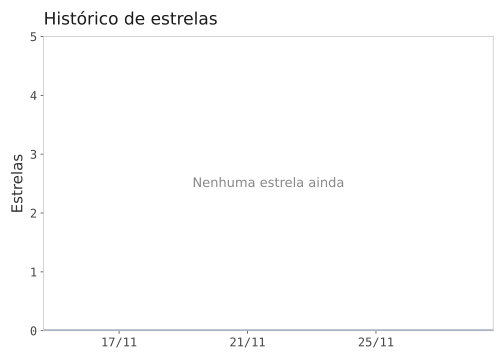
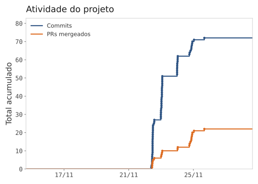

# Bíblia App

Aplicação web **offline-first (PWA)** para leitura e estudo da Bíblia: página de leitura com aparência de papel, marca-texto, anotações, busca ampla e planos de leitura.

[](https://github.com/edioilha/biblia-app/actions/workflows/ci.yml)
[](https://github.com/edioilha/biblia-app/actions/workflows/deploy.yml)

**App:** https://edioilha.github.io/biblia-app/

> 🚧 Em desenvolvimento — MVP em implementação. Já disponível: leitura em página de papel, navegação por capítulos, ida direta a uma referência (`jo 3:16`), favoritos de versículos e marca-texto em quatro cores, offline.
>
> **Progresso:** fase 7.3 de 7.9 entregue · próxima: 7.4 anotações · [roadmap completo](docs/09-roadmap.md)

## Stats

<table>
  <tr>
    <td width="50%"></td>
    <td width="50%"></td>
  </tr>
</table>

<sub>Atualizado automaticamente a cada push na <code>main</code> e diariamente pelo workflow <a href=".github/workflows/stats.yml"><code>stats</code></a>.</sub>

## Documentação

| # | Documento | Status |
|---|---|---|
| 01 | [Visão](docs/01-visao.md) | Em revisão |
| 02 | [Requisitos](docs/02-requisitos.md) | Em revisão |
| 03 | [Casos de uso](docs/03-casos-de-uso.md) | Em revisão |
| 04 | [Modelo de domínio (diagrama de classes)](docs/04-modelo-dominio.md) | Em revisão |
| 05 | [Wireframes](docs/05-wireframes/README.md) | Em revisão |
| 06 | [Arquitetura (C4, sequência, persistência, pastas)](docs/06-arquitetura.md) | Em revisão |
| 07 | [Padrões de desenvolvimento](docs/07-padroes-desenvolvimento.md) | Em revisão |
| 08 | [Backlog](docs/08-backlog.md) | Vivo |
| 09 | [Roadmap](docs/09-roadmap.md) | Vivo |
| — | [Decisões de arquitetura (ADRs)](docs/adr/README.md) | Em revisão |

## Stack

TypeScript · React · React Router · TanStack Query · Vite · Tailwind CSS · Dexie (IndexedDB) · PWA (Workbox) · Vitest · Testing Library · Playwright · ESLint · Prettier

## Desenvolvimento

Requisitos: Node.js 26 (ver `.nvmrc`).

```bash
npm install                     # dependências (+ hooks do Git via Husky)
npx playwright install          # navegadores para os testes E2E (1ª vez)

npm run dev                     # servidor local → http://localhost:5173/biblia-app/
npm test                        # testes unitários
npm run test:coverage           # testes + cobertura (mínimo 80% no domínio)
npm run test:e2e                # testes E2E (build + preview + Playwright)
npm run lint                    # ESLint (inclui regra de dependência entre camadas)
npm run typecheck               # TypeScript
npm run build                   # build de produção em dist/
npm run dados:blivre            # regenera public/dados/BLIVRE a partir do biblia.data
```

- Commits seguem **Conventional Commits** (validados pelo commitlint); o hook de pre-commit roda lint e Prettier nos arquivos alterados.
- No macOS 27 o Firefox do Playwright não inicia; localmente os testes E2E usam Chromium, WebKit e mobile — o Firefox roda no CI.
- Padrões completos: [docs/07-padroes-desenvolvimento.md](docs/07-padroes-desenvolvimento.md).

## Dados bíblicos

Textos de [Projeto-Euaggelion/biblia.data](https://github.com/Projeto-Euaggelion/biblia.data) (MIT). Apenas traduções em domínio público: Bíblia Livre, Almeida 1911, Tradução Brasileira.

A Bíblia Livre vem embarcada em `public/dados/BLIVRE/`, normalizada pelo script `npm run dados:blivre` (detalhes e limitações conhecidas em [docs/06 §7](docs/06-arquitetura.md#7-importação-e-normalização-dos-dados)).

## Licença

Código sob licença [MIT](LICENSE). Os textos bíblicos seguem as licenças de suas fontes (domínio público).
