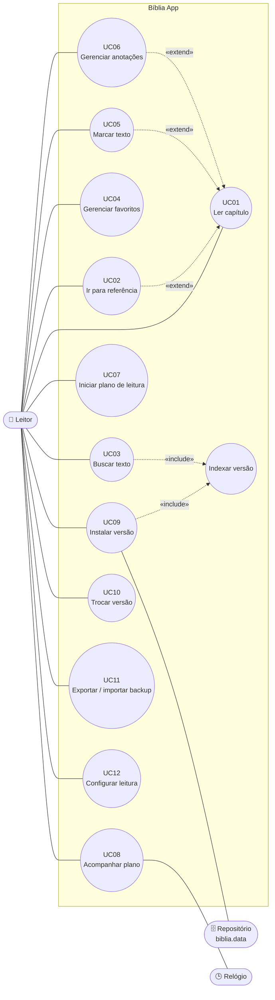

# 03 — Casos de Uso

## 1. Atores

| Ator | Tipo | Descrição |
|---|---|---|
| **Leitor** | Primário | Usuário final do app |
| **Repositório biblia.data** | Secundário (sistema externo) | Fornece os arquivos JSON das traduções para instalação |
| **Relógio do sistema** | Secundário | Data atual, usada pelos planos de leitura |

## 2. Diagrama de Casos de Uso

> Mermaid não possui sintaxe nativa de casos de uso; a notação abaixo é equivalente (atores à esquerda/direita, casos de uso como elipses, `<<include>>`/`<<extend>>` nas setas).

## 3. Lista de Casos de Uso

| ID | Caso de uso | Requisitos | Prior. |
|---|---|---|---|
| UC01 | Ler capítulo | RF01.1–RF01.6 | M |
| UC02 | Ir para referência | RF01.4 | M |
| UC03 | Buscar texto | RF02.x | M |
| UC04 | Gerenciar favoritos | RF03.x | M |
| UC05 | Marcar texto | RF04.x | M |
| UC06 | Gerenciar anotações | RF05.x | M |
| UC07 | Iniciar plano de leitura | RF06.1–RF06.2 | M |
| UC08 | Acompanhar plano | RF06.3–RF06.5 | M |
| UC09 | Instalar versão | RF07.3 | M |
| UC10 | Trocar versão | RF07.4 | M |
| UC11 | Exportar / importar backup | RF08.x | M |
| UC12 | Configurar leitura | RF01.7 | S |

## 4. Especificações

### UC01 — Ler capítulo

| Campo | Descrição |
|---|---|
| Ator | Leitor |
| Pré-condição | Ao menos uma versão instalada |
| Pós-condição | Capítulo exibido; última posição salva |

**Fluxo principal**
1. Leitor abre o app.
2. Sistema exibe o capítulo da **última posição** (ou Gênesis 1 na primeira execução) na versão ativa.
3. Sistema renderiza o texto em página de papel e aplica **destaques**, **marcadores de anotação** e **favoritos** daquele capítulo.
4. Leitor navega para o próximo/anterior (botão, tecla ← →, swipe).
5. Sistema exibe o novo capítulo (passo 3) e salva a posição.

**Fluxos alternativos**
- **A1 — Escolher livro/capítulo:** no passo 4, leitor abre o seletor, escolhe livro e capítulo; volta ao passo 3.
- **A2 — Limite do cânon:** em Apocalipse 22 → próximo, botão fica desabilitado (idem Gênesis 1 → anterior).

---

### UC03 — Buscar texto

| Campo | Descrição |
|---|---|
| Ator | Leitor |
| Pré-condição | Versão ativa indexada |
| Pós-condição | Resultados exibidos (nenhum estado alterado) |

**Fluxo principal**
1. Leitor abre a busca e digita o termo.
2. Após 250 ms sem digitação (*debounce*), sistema executa a busca na versão ativa, ignorando acentos e maiúsculas.
3. Sistema exibe a 1ª página (20 itens) com referência, texto com termos destacados e o total de ocorrências.
4. Leitor navega entre páginas.
5. Leitor clica em um resultado; sistema abre UC01 no capítulo, rolando e piscando o versículo.

**Fluxos alternativos**
- **A1 — Frase exata:** termo entre aspas → apenas correspondência exata da frase.
- **A2 — Filtros:** leitor aplica testamento/livros → sistema refaz a busca a partir da página 1.
- **A3 — Fuzzy:** sem resultados exatos → sistema sugere resultados aproximados.
- **A4 — Sem resultados:** sistema exibe mensagem e sugestões.

**Regras:** termo mínimo de 2 caracteres; resultados ordenados por relevância (padrão) ou ordem canônica.

---

### UC05 — Marcar texto

| Campo | Descrição |
|---|---|
| Ator | Leitor |
| Pré-condição | UC01 em execução |
| Pós-condição | Destaque persistido e visível |

**Fluxo principal**
1. Leitor seleciona um trecho do texto (mouse ou toque).
2. Sistema exibe barra flutuante: **Marcar**, **Anotar**, **Favoritar**, **Copiar**.
3. Leitor escolhe **Marcar**.
4. Sistema converte a seleção em `IntervaloTexto` (versículo + offset inicial → versículo + offset final), cria o `Destaque` em amarelo e o renderiza como marca-texto translúcido.

**Fluxos alternativos**
- **A1 — Sobreposição:** a seleção sobrepõe um destaque existente da mesma cor → sistema **funde** os destaques.
- **A2 — Remover:** leitor toca um destaque → escolhe **Remover** → sistema exclui (anotações vinculadas passam a apontar só para o versículo).
- **A3 — Seleção fora do texto bíblico:** número de versículo/títulos são ignorados ao calcular offsets.

---

### UC06 — Gerenciar anotações

| Campo | Descrição |
|---|---|
| Ator | Leitor |
| Pré-condição | UC01 em execução |
| Pós-condição | Anotação persistida e visível na página |

**Fluxo principal**
1. Leitor toca um versículo (ou destaque) e escolhe **Anotar**.
2. Sistema abre o editor com opção de exibição: **Inline** ou **Rodapé** (padrão: rodapé).
3. Leitor escreve a nota (Markdown básico) e salva.
4. Sistema persiste e renderiza:
   - **Rodapé:** marcador numerado (¹, ², …) após o versículo e a nota no rodapé da página.
   - **Inline:** bloco de nota logo abaixo do versículo.

**Fluxos alternativos**
- **A1 — Editar:** leitor toca a nota → edita → salva (atualiza `atualizadoEm`).
- **A2 — Excluir:** leitor exclui → sistema pede confirmação → remove.
- **A3 — Nota vazia:** sistema não permite salvar.

---

### UC08 — Acompanhar plano

| Campo | Descrição |
|---|---|
| Atores | Leitor, Relógio |
| Pré-condição | Plano iniciado (UC07) |
| Pós-condição | Progresso atualizado |

**Fluxo principal**
1. Leitor abre "Planos".
2. Sistema calcula o **dia atual** do plano (`hoje − dataInício + 1`) e exibe as leituras do dia, progresso (%) e dias em atraso.
3. Leitor abre a leitura (UC01).
4. Ao final do último capítulo da leitura, sistema oferece **Concluir dia**.
5. Leitor confirma; sistema registra o dia como concluído.

**Fluxos alternativos**
- **A1 — Atrasado:** sistema lista dias pendentes; leitor pode concluí-los em qualquer ordem.
- **A2 — Reagendar:** leitor escolhe reagendar → nova data de início = hoje − (dias concluídos consecutivos).
- **A3 — Plano concluído:** todos os dias concluídos → status `CONCLUIDO`.

---

### UC09 — Instalar versão

| Campo | Descrição |
|---|---|
| Atores | Leitor, Repositório biblia.data |
| Pré-condição | Conexão com a internet |
| Pós-condição | Versão disponível offline e indexada |

**Fluxo principal**
1. Leitor abre "Versões"; sistema lista as versões do catálogo com status (instalada / disponível).
2. Leitor escolhe **Instalar** em uma versão.
3. Sistema baixa os 66 arquivos JSON, exibindo progresso.
4. Sistema valida (66 livros, contagem de capítulos) e importa para o IndexedDB.
5. Sistema **indexa** a versão em Web Worker (include *Indexar versão*).
6. Sistema marca a versão como `INSTALADA`.

**Fluxos alternativos**
- **A1 — Falha de rede:** sistema mantém status `ERRO`, descarta dados parciais e permite tentar novamente.
- **A2 — Dados inválidos:** sistema aborta e registra o erro.
