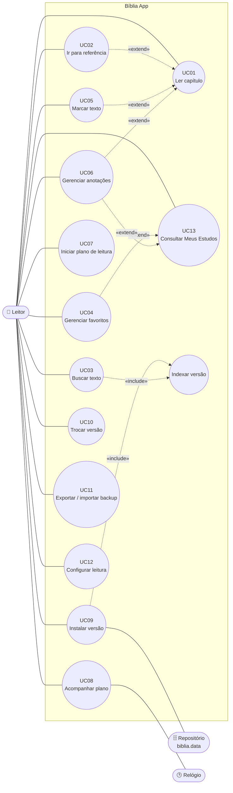

# 03 — Casos de Uso

## 1. Atores

| Ator | Tipo | Descrição |
|---|---|---|
| **Leitor** | Primário | Usuário final do app |
| **Repositório biblia.data** | Secundário (sistema externo) | Fornece os arquivos JSON das traduções para instalação |
| **Relógio do sistema** | Secundário | Data atual, usada pelos planos de leitura |

## 2. Diagrama de Casos de Uso

> Mermaid não possui sintaxe nativa de casos de uso; a notação abaixo é equivalente (atores à esquerda/direita, casos de uso como elipses, `<<include>>`/`<<extend>>` nas setas).

## 3. Lista de Casos de Uso

| ID | Caso de uso | Requisitos | Prior. |
|---|---|---|---|
| UC01 | Ler capítulo | RF01.1–RF01.6 | M |
| UC02 | Ir para referência | RF01.4 | M |
| UC03 | Buscar texto | RF02.x | M |
| UC04 | Gerenciar favoritos | RF03.x | M |
| UC05 | Marcar texto | RF04.x | M |
| UC06 | Gerenciar anotações | RF05.x | M |
| UC07 | Iniciar plano de leitura | RF06.1–RF06.2 | M |
| UC08 | Acompanhar plano | RF06.3–RF06.5 | M |
| UC09 | Instalar versão | RF07.3 | M |
| UC10 | Trocar versão | RF07.4 | M |
| UC11 | Exportar / importar backup | RF08.x | M |
| UC12 | Configurar leitura | RF01.7 | S |
| UC13 | Consultar Meus Estudos | RF09.x, RF03.2, RF04.6, RF05.6 | M |

## 4. Especificações

### UC01 — Ler capítulo

| Campo | Descrição |
|---|---|
| Ator | Leitor |
| Pré-condição | Ao menos uma versão instalada |
| Pós-condição | Capítulo exibido; última posição salva |

**Fluxo principal**
1. Leitor abre o app.
2. Sistema exibe o capítulo da **última posição** (ou Gênesis 1 na primeira execução) na versão ativa.
3. Sistema renderiza o texto em página de papel e aplica **destaques**, **marcadores de anotação** e **favoritos** daquele capítulo.
4. Leitor navega para o próximo/anterior (botão, tecla ← →, swipe).
5. Sistema exibe o novo capítulo (passo 3) e salva a posição.

**Fluxos alternativos**
- **A1 — Escolher livro/capítulo:** no passo 4, leitor abre o seletor, escolhe livro e capítulo; volta ao passo 3.
- **A2 — Limite do cânon:** em Apocalipse 22 → próximo, botão fica desabilitado (idem Gênesis 1 → anterior).

---

### UC03 — Buscar texto

| Campo | Descrição |
|---|---|
| Ator | Leitor |
| Pré-condição | Versão ativa indexada |
| Pós-condição | Resultados exibidos (nenhum estado alterado) |

**Fluxo principal**
1. Leitor abre **Buscar** (barra superior) e digita o termo.
2. Após 250 ms sem digitação (*debounce*), sistema executa a busca na versão ativa, ignorando acentos e maiúsculas. O modo padrão é **Todas as palavras**; a **última palavra vale como prefixo** a partir de 3 letras ("amo" encontra "amor", "amou"), para a busca funcionar enquanto se digita.
3. Sistema exibe a 1ª página (20 itens) com referência, texto com os termos encontrados em negrito sublinhado e o total de **versículos** encontrados ("152 versículos encontrados · página 1 de 8", anunciado ao leitor de tela).
4. Leitor navega entre páginas (paginação numérica com primeira/última e reticências), muda a ordenação (relevância ou ordem bíblica) ou o tamanho da página (10, 20 ou 50).
5. Leitor clica em um resultado; sistema abre UC01 no capítulo, rolando até o versículo e destacando-o. **Voltar** retorna à mesma busca e página: o estado da busca fica na URL (`#/buscar?q=…&t=NT&p=2`), o que também permite compartilhar o link.

**Fluxos alternativos**
- **A1 — Frase exata:** termo entre aspas (ou o chip **Frase exata**) → só a sequência exata das palavras, ignorando a pontuação entre elas; a frase inteira é destacada. Escolher outro modo tira as aspas do termo.
- **A1b — Qualquer palavra:** chip **Qualquer palavra** → versículos com ao menos um dos termos.
- **A2 — Filtros:** chips **Toda a Bíblia / AT / NT** e o diálogo **Livros** (caixas de marcar por testamento) → sistema refaz a busca a partir da página 1. Escolher um testamento descarta os livros do outro.
- **A3 — Aproximada (fuzzy):** chip **≈ Aproximada**, desligado por padrão (só em palavras de 4+ letras). Sem resultados exatos, o sistema oferece **Buscar resultados aproximados**.
- **A4 — Sem resultados:** "Nenhum versículo encontrado para …" e sugestões conforme o caso: aproximada, buscar em toda a Bíblia (se há filtro), buscar as palavras em qualquer ordem (se frase exata).
- **A5 — Índice em preparo:** o índice é montado em segundo plano ao abrir o app; se o leitor buscar antes de ficar pronto, o sistema mostra "Preparando a busca…" e responde quando terminar.

**Regras:** termo mínimo de 2 letras ou números; resultados ordenados por relevância (padrão) ou ordem canônica.

**Fora desta fase:** buscar nas anotações (RF02.9) entra com Meus Estudos (UC13, 7.6); histórico de buscas (RF02.10) e seletor de intervalo de livros ficam no backlog (BL-08, BL-09).

---

### UC04 — Gerenciar favoritos

| Campo | Descrição |
|---|---|
| Ator | Leitor |
| Pré-condição | UC01 em execução |
| Pós-condição | Versículo marcado (ou desmarcado) como favorito; ★ atualizada na página |

**Fluxo principal**
1. Leitor toca/clica no **número do versículo** (ou o aciona pelo teclado).
2. Sistema abre a **barra de ações do versículo** (rodapé da tela), com o foco na primeira ação.
3. Leitor escolhe **☆ Favoritar**.
4. Sistema exibe a ★ antes do número na hora (atualização otimista), fecha a barra, devolve o foco ao número do versículo e anuncia "João 3:16 adicionado aos favoritos".
5. Sistema grava o favorito.

**Fluxos alternativos**
- **A1 — Desfavoritar:** no passo 3, se o versículo já é favorito, a ação é **★ Remover favorito**; sistema remove a ★ e o favorito.
- **A2 — Fechar sem ação:** leitor toca em ✕, pressiona Esc ou toca de novo no número; a barra fecha e o foco volta ao número. Trocar de capítulo também fecha a barra.
- **A3 — Falha ao gravar:** sistema desfaz a ★ e exibe aviso de erro.
- **A4 — Listar favoritos (RF03.2):** pela tela Meus Estudos (UC13, fase 7.6).

**Regras:** no máximo um favorito por versículo; favoritos valem para qualquer versão (pertencem à referência, não ao texto).

---

### UC05 — Marcar texto

| Campo | Descrição |
|---|---|
| Ator | Leitor |
| Pré-condição | UC01 em execução |
| Pós-condição | Destaque persistido e visível |

**Fluxo principal**
1. Leitor seleciona um trecho do texto (mouse, toque ou teclado), dentro de um versículo ou atravessando vários.
2. Sistema exibe a **barra de seleção** no rodapé da tela (desktop e celular, sem disputar espaço com o menu nativo de seleção): **Marcar** com as cores amarelo, verde, rosa e azul. A barra não rouba o foco, para o leitor continuar ajustando a seleção.
3. Leitor escolhe uma cor (amarelo é a primeira, RF04.3).
4. Sistema converte a seleção em `IntervaloTexto` (versículo + offset inicial → versículo + offset final) e **ajusta a palavras inteiras**: descarta espaços nas pontas e estende a ponta que cai no meio de uma palavra.
5. Sistema aplica a **regra de sobreposição** (A1, A2), grava o resultado de uma vez, limpa a seleção, renderiza o trecho como marca-texto translúcido e anuncia "Trecho marcado em amarelo".

**Fluxos alternativos**
- **A1 — Mesma cor:** a seleção sobrepõe um destaque da mesma cor, ou está separada dele **só por espaço** (inclusive na passagem entre versículos) → os destaques são **fundidos**. O resultado fica com o id e a data do mais antigo.
- **A2 — Outra cor (decisão da fase 7.3):** **o mais recente vence**. O destaque antigo é cortado no trecho sobreposto, dividido em dois se o novo cair no meio dele, ou removido se ficar coberto por inteiro. Assim os destaques de um capítulo **nunca se sobrepõem**.
- **A3 — Seleção fora do texto bíblico:** número de versículo, títulos e o espaço entre versículos não contam nos offsets; uma ponta fora do texto vai para o texto mais próximo dentro da seleção. Seleção sem texto bíblico não abre a barra.
- **A4 — Tocar num destaque:** leitor toca/clica no trecho marcado (sem selecionar) → sistema abre a **barra do destaque** (ex.: "João 3:16–17") com o foco nela: as quatro cores (a atual indicada), **Anotar** (UC06) e **Remover**.
  - **Trocar a cor** (RF04.5): segue a regra de sobreposição (pode fundir com vizinhos da nova cor).
  - **Remover** (RF04.4): exclui o destaque inteiro. Anotações vinculadas a ele passam a aparecer no versículo (UC06 A5).
  - Na **fusão** (A1), as anotações do destaque que deixa de existir passam para o que fica, na mesma transação.
- **A5 — Desmarcar trecho (borracha):** se a seleção cobre algum destaque, a barra de seleção mostra também **Desmarcar**, que tira exatamente o trecho selecionado (sem ajuste a palavras) de todos os destaques.
- **A6 — Pelo teclado:** a barra de ações do versículo (UC04) mostra **Remover marcação** quando o versículo tem marca-texto, e apaga a marcação só desse versículo. É o caminho acessível, pois o `<mark>` não recebe foco (virar botão atrapalharia a seleção de texto).
- **A7 — Cancelar:** ✕ ou Esc fecham a barra e desfazem a seleção.
- **A8 — Falha ao gravar:** sistema exibe aviso de erro e o texto fica como estava.

**Fora desta fase:** *Favoritar* fica no número do versículo (UC04). *Copiar* é o do próprio sistema. A listagem de destaques (RF04.6) fica em Meus Estudos (UC13, 7.6).

---

### UC06 — Gerenciar anotações

| Campo | Descrição |
|---|---|
| Ator | Leitor |
| Pré-condição | UC01 em execução |
| Pós-condição | Anotação persistida e visível na página |

**Fluxo principal**
1. Leitor escolhe **Anotar** na barra do versículo (UC04) ou na barra de um destaque (UC05 A4). Não há *Anotar* na barra de seleção: para anotar um trecho, ele é marcado antes.
2. Sistema abre o editor num diálogo modal (no celular, ocupa a parte de baixo da tela), com o foco no texto e a opção de exibição: **Rodapé** (padrão) ou **Inline**.
3. Leitor escreve a nota em Markdown básico (RF05.5: **negrito**, *itálico*, listas `-` e `1.`, parágrafos) e salva (botão ou Ctrl/⌘+Enter).
4. Sistema persiste, fecha o editor, devolve o foco ao número do versículo, anuncia "Nota salva em João 3:16" e renderiza:
   - **Rodapé:** marcador numerado (1, 2, … na ordem do capítulo) no fim do versículo, ou no fim do trecho quando a nota é de um destaque. As notas ficam no pé da página; o marcador leva até a nota, e a nota tem **Voltar ao texto** (↩) e **Editar nota**.
   - **Inline:** bloco logo abaixo do versículo, com **Editar nota**. O texto do capítulo é dividido em parágrafos nesse ponto.

**Fluxos alternativos**
- **A1 — Editar:** leitor escolhe **Editar nota** (rodapé ou bloco inline) → altera o texto e/ou o modo de exibição → salva (atualiza `atualizadoEm`).
- **A2 — Excluir:** no editor de uma nota existente, **Excluir** → o diálogo pede confirmação (**Excluir nota** / **Manter**) → remove e anuncia "Nota excluída".
- **A3 — Nota vazia:** **Salvar** fica desabilitado enquanto o texto só tem espaços.
- **A4 — Cancelar:** **Cancelar** ou Esc fecham sem gravar.
- **A5 — Destaque inexistente (leitura tolerante):** uma nota de destaque cujo destaque foi removido, ou que não existe na versão aberta (destaques são por versão; notas não), aparece no fim do versículo.
- **A6 — Falha ao gravar:** o erro aparece dentro do editor, que continua aberto com o texto.

**Regras (decisões da fase 7.4):** várias notas por versículo; as notas valem para qualquer versão; tamanho máximo de 10.000 caracteres; o Markdown é convertido em elementos React por um parser próprio (sem HTML do usuário).

---

### UC08 — Acompanhar plano

| Campo | Descrição |
|---|---|
| Atores | Leitor, Relógio |
| Pré-condição | Plano iniciado (UC07) |
| Pós-condição | Progresso atualizado |

**Fluxo principal**
1. Leitor abre "Planos".
2. Sistema calcula o **dia atual** do plano (`hoje − dataInício + 1`) e exibe as leituras do dia, progresso (%) e dias em atraso.
3. Leitor abre a leitura (UC01).
4. Ao final do último capítulo da leitura, sistema oferece **Concluir dia**.
5. Leitor confirma; sistema registra o dia como concluído.

**Fluxos alternativos**
- **A1 — Atrasado:** sistema lista dias pendentes; leitor pode concluí-los em qualquer ordem.
- **A2 — Reagendar:** leitor escolhe reagendar → nova data de início = hoje − (dias concluídos consecutivos).
- **A3 — Plano concluído:** todos os dias concluídos → status `CONCLUIDO`.

---

### UC09 — Instalar versão

| Campo | Descrição |
|---|---|
| Atores | Leitor, Repositório biblia.data |
| Pré-condição | Conexão com a internet |
| Pós-condição | Versão disponível offline e indexada |

**Fluxo principal**
1. Leitor abre "Versões"; sistema lista as versões do catálogo com status (instalada / disponível).
2. Leitor escolhe **Instalar** em uma versão.
3. Sistema baixa os 66 arquivos JSON, exibindo progresso.
4. Sistema valida (66 livros, contagem de capítulos) e importa para o IndexedDB.
5. Sistema **indexa** a versão em Web Worker (include *Indexar versão*).
6. Sistema marca a versão como `INSTALADA`.

**Fluxos alternativos**
- **A1 — Falha de rede:** sistema mantém status `ERRO`, descarta dados parciais e permite tentar novamente.
- **A2 — Dados inválidos:** sistema aborta e registra o erro.

---

### UC13 — Consultar Meus Estudos

| Campo | Descrição |
|---|---|
| Ator | Leitor |
| Pré-condição | — |
| Pós-condição | Lista exibida; eventuais remoções/edições persistidas |

**Fluxo principal**
1. Leitor abre **Meus Estudos**.
2. Sistema exibe as abas **Favoritos**, **Destaques** e **Anotações** com o total de cada uma; a aba **Favoritos** vem selecionada.
3. Sistema lista os itens da aba (20 por página) em ordem bíblica, cada um com referência e trecho do texto (e a nota, na aba Anotações).
4. Leitor clica em um item; sistema abre UC01 no capítulo, rolando até o versículo.

**Fluxos alternativos**
- **A1 — Trocar aba:** sistema mantém filtro de texto/livro e volta à página 1.
- **A2 — Filtrar:** leitor digita texto ou escolhe livro → sistema refaz a lista a partir da página 1.
- **A3 — Ordenar por data:** sistema ordena do mais recente para o mais antigo.
- **A4 — Ações do item (⋮):** remover (com confirmação); editar nota (UC06); alterar cor do destaque (UC05).
- **A5 — Lista vazia:** sistema exibe orientação ("Selecione um texto na leitura para marcar…").
