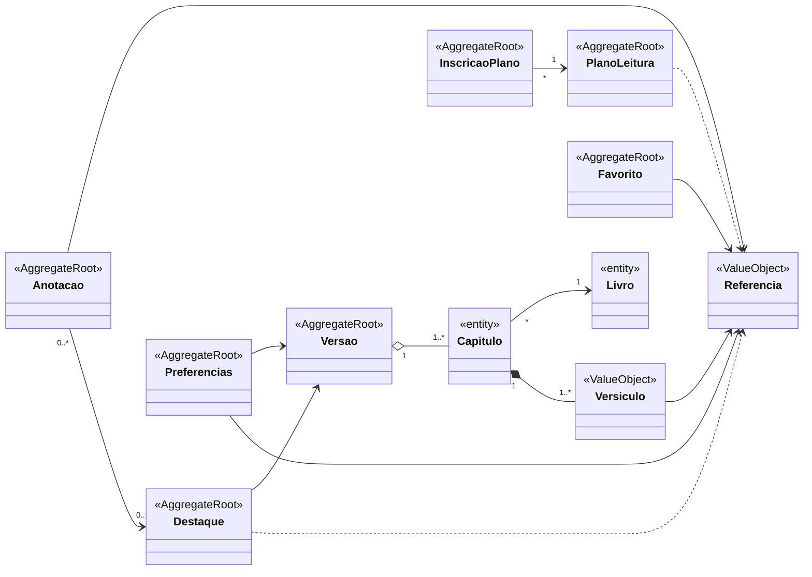
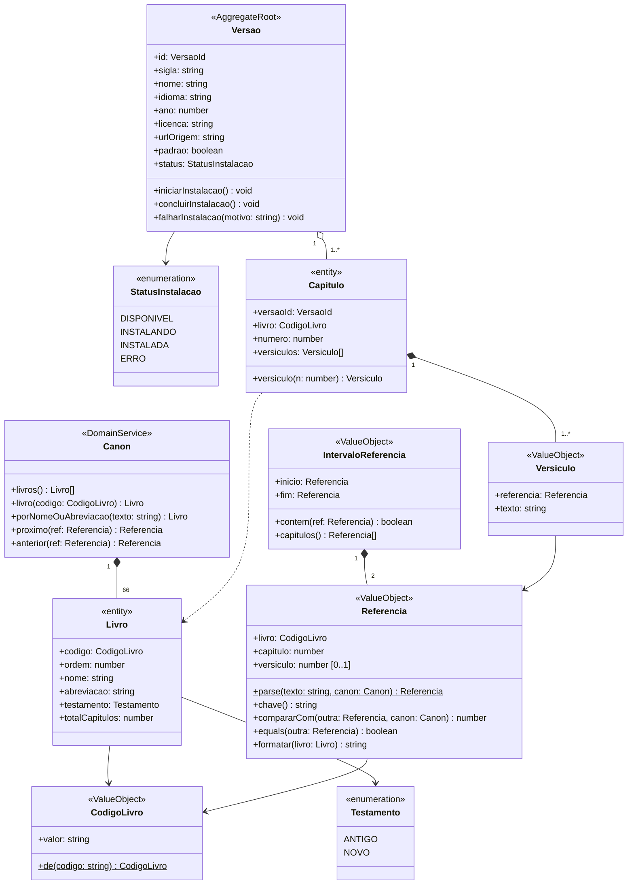
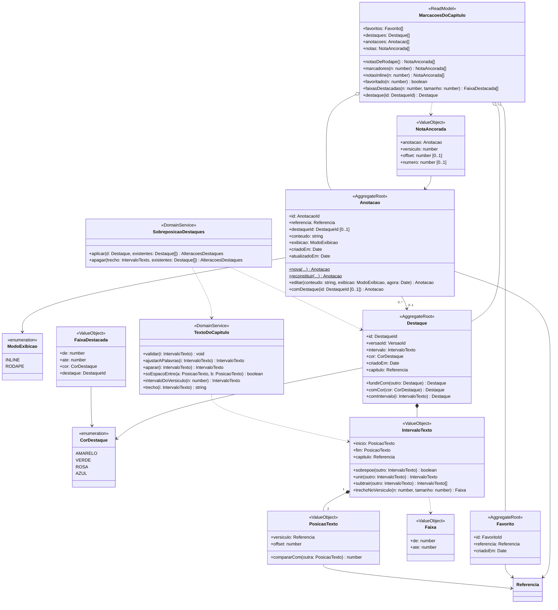
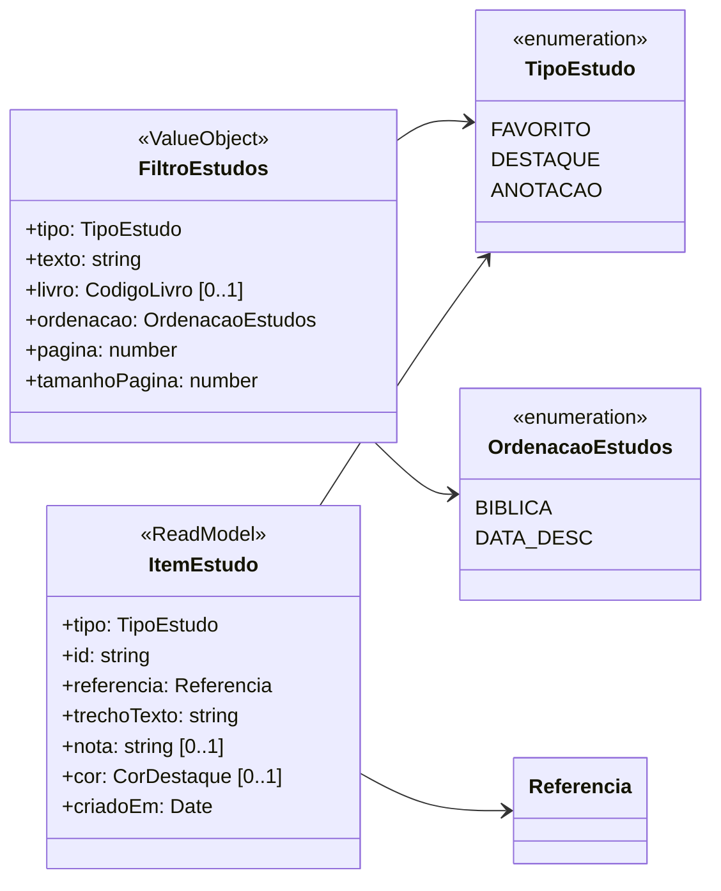
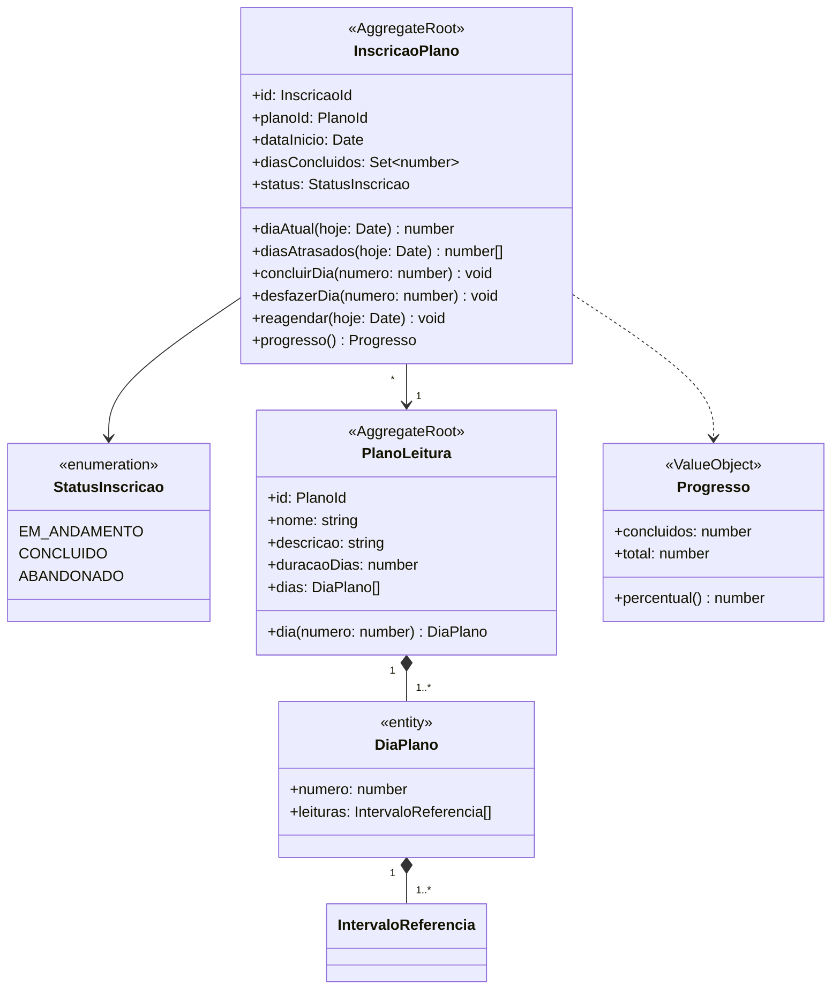
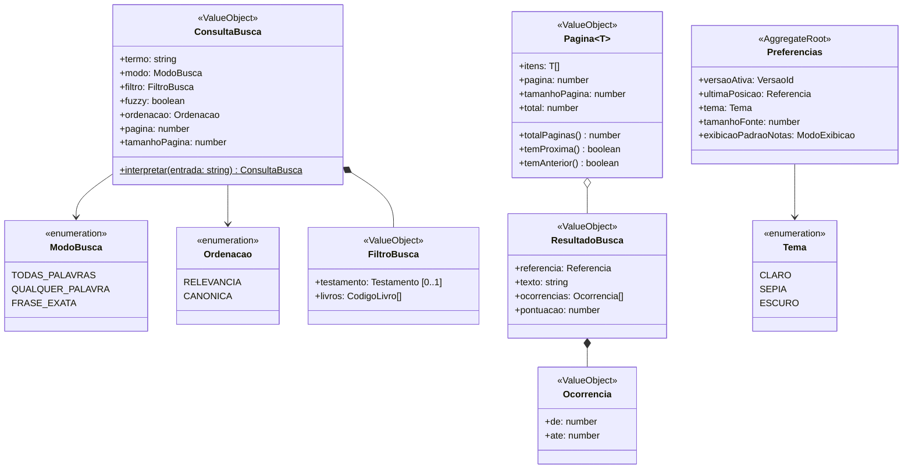

# 04 — Modelo de Domínio (Diagrama de Classes)

## 1. Abordagem

- **DDD tático:** *Entities*, *Value Objects*, *Aggregates* e *Repositories*.
- **Linguagem ubíqua em português** nos conceitos de domínio.
- O domínio **não depende** de React, Dexie ou MiniSearch; estes ficam na infraestrutura e implementam as **portas** (interfaces).
- Identificadores: `UUID v7` gerados no cliente (ordenáveis por tempo), tipados como *branded types* (`FavoritoId`, `DestaqueId`…).

### Módulos (bounded contexts)

| Módulo | Responsabilidade |
|---|---|
| `biblia` | Cânon, versões, texto bíblico, referências |
| `estudo` | Favoritos, destaques, anotações |
| `planos` | Planos de leitura e progresso |
| `busca` | Consulta e resultados paginados |
| `preferencias` | Posição de leitura, versão ativa, tema |

## 2. Visão geral

## 3. Módulo `biblia`

**Notas**
- `Livro` é **canônico** (66 livros, mesmos códigos USFM do `biblia.data`: `GEN`, `JHN`…) e independe da versão.
- `Referencia.chave()` gera a chave de persistência, ex.: `JHN.3.16`.
- `Referencia.parse()` aceita `Jo 3:16`, `João 3.16`, `jo 3`, `1 Co 13` etc.

## 4. Módulo `estudo`

**Invariantes**
- `IntervaloTexto`: `inicio < fim` (nunca vazio), dentro de **um único capítulo**; offsets ≥ 0. Que os offsets cabem no texto dos versículos é verificado por `TextoDoCapitulo.validar()`, que conhece o texto.
- Os destaques de uma versão num capítulo **nunca se sobrepõem** (`SobreposicaoDestaques`, UC05 A1/A2).
- `Anotacao.conteudo` não pode ser vazio (após aparar espaços) nem passar de 10.000 caracteres; a referência é de **versículo**.
- Um versículo tem **no máximo um** `Favorito`.
- `Destaque` pertence a uma versão (offsets dependem do texto); `Favorito` e `Anotacao` são **independentes de versão**.
- `MarcacoesDoCapitulo` é um *read model* montado para a renderização de um capítulo (não é persistido).

**Offsets:** contam unidades UTF-16 (como o DOM) a partir do início do texto do versículo, sem o número. O intervalo é semiaberto: `[inicio, fim)`.

### 4.1 Consulta "Meus Estudos"

- `ConsultarMeusEstudos` retorna `Pagina<ItemEstudo>`; filtro e ordenação são feitos em memória (volume de dados do usuário é pequeno e local).

## 5. Módulo `planos`

**Invariantes**
- `concluirDia(n)`: `1 ≤ n ≤ duracaoDias`; ao concluir todos → `status = CONCLUIDO`.
- `diaAtual(hoje)` é limitado a `[1, duracaoDias]`.
- Planos pré-definidos são dados estáticos (JSON versionado no repositório).

## 6. Módulos `busca` e `preferencias`

- `ConsultaBusca.interpretar('"amor de Deus"')` → `FRASE_EXATA`; sem aspas → `TODAS_PALAVRAS`.

## 7. Portas (interfaces) e Casos de Uso — camada de aplicação

```mermaid
classDiagram
    direction LR

    class VersaoRepository {
        <<interface>>
        +listar() Promise~Versao[]~
        +obter(id: VersaoId) Promise~Versao~
        +salvar(v: Versao) Promise~void~
        +remover(id: VersaoId) Promise~void~
    }
    class TextoBiblicoRepository {
        <<interface>>
        +obterCapitulo(v: VersaoId, l: CodigoLivro, n: number) Promise~Capitulo~
        +obterVersiculos(v: VersaoId, refs: Referencia[]) Promise~Versiculo[]~
        +importar(v: VersaoId, livros: LivroImportado[]) Promise~void~
        +removerVersao(v: VersaoId) Promise~void~
    }
    class FavoritoRepository {
        <<interface>>
        +porCapitulo(capitulo: Referencia) Promise~Favorito[]~
        +porReferencia(versiculo: Referencia) Promise~Favorito~
        +listar() Promise~Favorito[]~
        +salvar(f: Favorito) Promise~void~
        +remover(id: FavoritoId) Promise~void~
    }
    class DestaqueRepository {
        <<interface>>
        +porCapitulo(v: VersaoId, capitulo: Referencia) Promise~Destaque[]~
        +porId(id: DestaqueId) Promise~Destaque~
        +listar() Promise~Destaque[]~
        +aplicar(a: AlteracoesDestaques) Promise~void~
    }
    class AnotacaoRepository {
        <<interface>>
        +porCapitulo(capitulo: Referencia) Promise~Anotacao[]~
        +porId(id: AnotacaoId) Promise~Anotacao~
        +listar() Promise~Anotacao[]~
        +salvar(a: Anotacao) Promise~void~
        +remover(id: AnotacaoId) Promise~void~
    }
    class PlanoRepository {
        <<interface>>
        +listar() Promise~PlanoLeitura[]~
        +obter(id: PlanoId) Promise~PlanoLeitura~
    }
    class InscricaoRepository {
        <<interface>>
        +ativas() Promise~InscricaoPlano[]~
        +salvar(i: InscricaoPlano) Promise~void~
    }
    class PreferenciasRepository {
        <<interface>>
        +obter() Promise~Preferencias~
        +salvar(p: Preferencias) Promise~void~
    }
    class ServicoBusca {
        <<interface>>
        +preparar(v: VersaoId) Promise~void~
        +buscar(v: VersaoId, c: ConsultaBusca) Promise~Pagina~
    }
    class FonteVersoes {
        <<interface>>
        +catalogo() Promise~Versao[]~
        +baixar(v: VersaoId, progresso: Callback) Promise~LivroImportado[]~
    }
    class Relogio {
        <<interface>>
        +agora() Date
    }

    class GeradorId {
        <<interface>>
        +novo() string
    }

    class AbrirCapitulo {
        <<UseCase>>
        +executar(ref: Referencia) Promise~CapituloAberto~
    }
    class BuscarTexto {
        <<UseCase>>
        +executar(c: ConsultaBusca) Promise~Pagina~
    }
    class AlternarFavorito {
        <<UseCase>>
        +executar(ref: Referencia) Promise~boolean~
    }
    class ObterMarcacoesDoCapitulo {
        <<UseCase>>
        +executar(v: VersaoId, ref: Referencia) Promise~MarcacoesDoCapitulo~
    }
    class MarcarTexto {
        <<UseCase>>
        +executar(v: VersaoId, i: IntervaloTexto, cor: CorDestaque) Promise~Destaque~
    }
    class DesmarcarTexto {
        <<UseCase>>
        +executar(v: VersaoId, i: IntervaloTexto) Promise~boolean~
    }
    class RemoverDestaque {
        <<UseCase>>
        +executar(id: DestaqueId) Promise~void~
    }
    class AlterarCorDestaque {
        <<UseCase>>
        +executar(id: DestaqueId, cor: CorDestaque) Promise~Destaque~
    }
    class CriarAnotacao {
        <<UseCase>>
        +executar(alvo: AlvoAnotacao, conteudo: string, exibicao: ModoExibicao) Promise~Anotacao~
    }
    class EditarAnotacao {
        <<UseCase>>
        +executar(id: AnotacaoId, conteudo: string, exibicao: ModoExibicao) Promise~Anotacao~
    }
    class ExcluirAnotacao {
        <<UseCase>>
        +executar(id: AnotacaoId) Promise~void~
    }
    class IniciarPlano {
        <<UseCase>>
        +executar(p: PlanoId) Promise~InscricaoPlano~
    }
    class ConcluirDiaPlano {
        <<UseCase>>
        +executar(i: InscricaoId, dia: number) Promise~void~
    }
    class InstalarVersao {
        <<UseCase>>
        +executar(v: VersaoId) Promise~void~
    }
    class ConsultarMeusEstudos {
        <<UseCase>>
        +executar(f: FiltroEstudos) Promise~Pagina~
    }
    class ExportarDados {
        <<UseCase>>
        +executar() Promise~Backup~
    }
    class ImportarDados {
        <<UseCase>>
        +executar(b: Backup) Promise~void~
    }

    AbrirCapitulo ..> TextoBiblicoRepository
    AbrirCapitulo ..> PreferenciasRepository
    BuscarTexto ..> ServicoBusca
    AlternarFavorito ..> FavoritoRepository
    AlternarFavorito ..> Relogio
    AlternarFavorito ..> GeradorId
    ObterMarcacoesDoCapitulo ..> FavoritoRepository
    ObterMarcacoesDoCapitulo ..> DestaqueRepository
    ObterMarcacoesDoCapitulo ..> AnotacaoRepository
    MarcarTexto ..> TextoBiblicoRepository
    MarcarTexto ..> DestaqueRepository
    MarcarTexto ..> Relogio
    MarcarTexto ..> GeradorId
    DesmarcarTexto ..> DestaqueRepository
    RemoverDestaque ..> DestaqueRepository
    AlterarCorDestaque ..> DestaqueRepository
    CriarAnotacao ..> AnotacaoRepository
    CriarAnotacao ..> Relogio
    CriarAnotacao ..> GeradorId
    EditarAnotacao ..> AnotacaoRepository
    EditarAnotacao ..> Relogio
    ExcluirAnotacao ..> AnotacaoRepository
    IniciarPlano ..> PlanoRepository
    IniciarPlano ..> InscricaoRepository
    IniciarPlano ..> Relogio
    ConcluirDiaPlano ..> InscricaoRepository
    InstalarVersao ..> FonteVersoes
    InstalarVersao ..> VersaoRepository
    InstalarVersao ..> TextoBiblicoRepository
    InstalarVersao ..> ServicoBusca
    ConsultarMeusEstudos ..> FavoritoRepository
    ConsultarMeusEstudos ..> DestaqueRepository
    ConsultarMeusEstudos ..> AnotacaoRepository
    ConsultarMeusEstudos ..> TextoBiblicoRepository
    ExportarDados ..> FavoritoRepository
    ExportarDados ..> DestaqueRepository
    ExportarDados ..> AnotacaoRepository
    ExportarDados ..> InscricaoRepository
    ImportarDados ..> FavoritoRepository
    ImportarDados ..> DestaqueRepository
    ImportarDados ..> AnotacaoRepository
    ImportarDados ..> InscricaoRepository
```

**Notas de implementação (fase 7.1)**
- `AbrirCapitulo` retorna, por ora, `CapituloAberto` (capítulo, livro, `anterior`/`proximo` e `versiculoEmFoco`); favoritos, destaques e anotações ficam em um caso de uso separado (revisto na fase 7.2, abaixo).
- `TextoBiblicoRepository` ganhou `possuiVersao()`; `importar()` é atômico.
- Porta adicional `FonteVersaoEmbarcada` (lê a BLIVRE de `public/dados`) e caso de uso `PrepararVersaoPadrao` (importação na primeira execução) e `ObterPosicaoInicial`.
- `Versao` ainda sem `StatusInstalacao` (entra com UC09); `Preferencias` só com `versaoAtiva` e `ultimaPosicao` (tema/fonte com UC12).
- `Referencia.deChave()` é o inverso de `chave()`; `Referencia.doCapitulo()` descarta o versículo.

**Notas de implementação (fase 7.2)**
- **Marcações separadas do texto:** `AbrirCapitulo` continua devolvendo `CapituloAberto` (texto + navegação) e salvando a posição; as marcações vêm de `ObterMarcacoesDoCapitulo` → `MarcacoesDoCapitulo`. Assim, favoritar recarrega só as marcações, sem reler o texto nem regravar a posição (ver docs/06 §5.1). Nesta fase `MarcacoesDoCapitulo` tem só `favoritos` e `favoritado(n)`; destaques e anotações entram em 7.3/7.4.
- `FavoritoRepository` recebe `Referencia` (como `TextoBiblicoRepository`) e ganhou `porReferencia()` para o `AlternarFavorito`; `listar()` entra com UC13 (fase 7.6).
- `AlternarFavorito` devolve o novo estado (`true` = favoritado), usado no aviso ao leitor de tela.
- `Favorito.criar()` exige referência de **versículo**; `FavoritoId` valida o formato UUID.
- `Relogio` expõe `agora()` (o "hoje" dos planos deriva dele); nova porta `GeradorId` (UUID v7 gerado fora do domínio, que não usa bibliotecas externas — ADR 0006).

**Notas de implementação (fase 7.3)**
- **Destaque imutável**, como `Favorito`: `comCor()`, `comIntervalo()` e `fundirCom()` devolvem um novo valor com o mesmo `id` (no lugar do `alterarCor(): void` previsto). Na fusão, o resultado fica com o id e a data do **mais antigo**, para que o que já aponta para ele (anotações, 7.4) continue válido.
- **Regras que dependem do texto** ficam no domain service `TextoDoCapitulo` (ajuste a palavras, aparar espaços, "só espaço entre", trecho para exibição). A **regra de sobreposição** fica em `SobreposicaoDestaques`, que devolve `AlteracoesDestaques` (`salvar` + `remover`).
- `DestaqueRepository.aplicar()` grava e remove numa **única transação**, para nunca persistir destaques sobrepostos. `PosicaoTexto` é persistida como `[versículo, offset]`; livro e capítulo ficam no registro.
- Casos de uso: `MarcarTexto` (ajusta e aplica a regra), `DesmarcarTexto` (borracha, sem ajuste), `RemoverDestaque` e `AlterarCorDestaque` (reaplica a regra, pode fundir). Os que precisam do texto carregam o capítulo por `TextoBiblicoRepository`.
- `ObterMarcacoesDoCapitulo` recebe a **versão** exibida: favoritos valem para qualquer versão, destaques não.
- `MarcacoesDoCapitulo.faixasDestacadas(n, tamanho)` recebe o tamanho do texto do versículo (o read model não carrega o texto); `listar()` dos repositórios entra com UC13 (fase 7.6).
- Ids: `FavoritoId` e `DestaqueId` validam UUID com o mesmo utilitário (`dominio/compartilhado/uuid.ts`).

**Notas de implementação (fase 7.4)**
- **Anotacao imutável**, como `Destaque`: `nova()` cria, `reconstituir()` valida o que vem do banco, `editar()` e `comDestaque()` devolvem um novo valor com o mesmo `id`. No lugar dos previstos `editar(): void`, `alterarExibicao()` e `desvincularDestaque()`: o editor muda texto e modo juntos, e desvincular não é necessário (leitura tolerante, abaixo).
- Casos de uso `CriarAnotacao` (alvo = versículo, ou versículo + destaque), `EditarAnotacao` e `ExcluirAnotacao`, no lugar do `SalvarAnotacao` com DTO.
- **Ancoragem** em `MarcacoesDoCapitulo.notas` (`NotaAncorada`): nota de destaque vai para o fim do trecho (versículo e offset do fim do intervalo); as demais, para o fim do versículo (`offset` nulo). Ordem: versículo, offset, criação, id; as de rodapé recebem `numero` 1..n nessa ordem.
- **Leitura tolerante:** se o `destaqueId` não está entre os destaques carregados (removido, ou de outra versão — destaques são por versão, notas não), a nota ancora no versículo. Por isso remover um destaque não precisa mexer nas notas.
- **Fusão de destaques:** `AlteracoesDestaques` ganhou `religar` (`{de, para}`): as notas do destaque que some passam ao sobrevivente, na mesma transação de `DestaqueRepository.aplicar()`.
- `ObterMarcacoesDoCapitulo` carrega favoritos, destaques e anotações em paralelo.

**Notas de implementação (fase 7.5)**
- `ConsultaBusca.interpretar(entrada, opções)` guarda o termo (sem aspas) e os `termos` normalizados; aspas forçam `FRASE_EXATA`. `pesquisavel` aplica o termo mínimo; `com()` devolve uma cópia alterada.
- `FiltroBusca.de(testamento, livros)` descarta livros fora do testamento; `aceita(livro)` decide o filtro.
- Normalização (`normalizarTermo`, `tokenizar`) e destaque (`ocorrenciasDosTermos`, `ocorrenciasDaFrase`) são funções puras do domínio, usadas pelo índice e pela verificação da frase exata. `ResultadoBusca.ocorrencias` usa `Ocorrencia` (`[de, ate)`, próprio do módulo `busca`) em vez de `Faixa`.
- `ServicoBusca.preparar()` substitui `indexar(progresso)`: o índice é montado em memória (ADR 0005, revisão da 7.5), sem progresso. Casos de uso `BuscarTexto` (página vazia abaixo do termo mínimo) e `PrepararBusca` (pré-carrega o índice). `InstalarVersao` (7.8) vai chamar `preparar` da nova versão.
- No adapter, `MotorBusca` (classe pura sobre o MiniSearch) usa como id de documento `ordem do livro × 10⁶ + capítulo × 10³ + versículo`: ordenar e filtrar não exigem campos extras.

**Notas de implementação (fase 7.6)**
- No lugar de `listar()`: `FavoritoRepository.todos()`, `DestaqueRepository.daVersao(versao)` (faixa da versão no índice `[versaoId+livro+capitulo]`) e `AnotacaoRepository.todas()`. Sem índices novos: o schema continua na v4.
- `ConsultaEstudos` (value object do módulo `estudo`): aba, filtro de texto (palavras normalizadas, todas obrigatórias, como substring), livro, ordem (`BIBLICA` | `RECENTES`), página e tamanho (20). `correspondeTexto()` olha o versículo ou o trecho e, nas anotações, também a nota (RF02.9). `comparar()` desempata pela ordem bíblica, pelo offset (destaques) e pela data.
- `ItemEstudo` = marcação + texto exibido (versículo; nos destaques, só o trecho via `TextoDoCapitulo.trecho()`). A data da ordem "mais recentes" é `criadoEm` (favorito, destaque) ou `atualizadoEm` (anotação).
- Casos de uso `ListarEstudos` (filtra, ordena e pagina em memória; devolve `Pagina<ItemEstudo>` e o total de cada aba com os mesmos filtros; `Pagina` vem do módulo `busca`) e `RemoverFavorito` (por id; `AlternarFavorito` continua na leitura).

**Notas de implementação (fase 7.7)**
- **`DataLocal`** (value object): dia do calendário local, sem hora nem fuso; conta dias com UTC por dentro (horário de verão não desloca o "dia 2"). `de(instante)` usa o dia local; `iso()`/`paraIso()` no formato `AAAA-MM-DD`.
- **`PlanoLeitura`/`DiaPlano`**: cada dia guarda **capítulos inteiros** (`Referencia` de capítulo) no lugar de `IntervaloReferencia[]`; `sequencias()` agrupa capítulos seguidos de um livro para exibir ("Juízes 4–6"). `PlanoId` é um identificador legível e estável ("biblia-1-ano").
- **`InscricaoPlano` imutável**, com `totalDias` copiado do plano (a inscrição não depende do catálogo) e `inicio: DataLocal`. **`status` é derivado** (`CONCLUIDO` quando todos os dias estão concluídos); `ABANDONADO` saiu: encerrar um plano apaga a inscrição (`EncerrarPlano`). `diaDe(hoje)` devolve `null` antes do início; `diasAtrasados(hoje)`, `primeiroPendente()`, `progresso()` (percentual arredondado para baixo), `concluirDia`/`desfazerDia` e `reagendar(hoje)` (o primeiro pendente vira hoje).
- Portas: **`CatalogoPlanos`** (`todos`, `porId`) no lugar de `PlanoRepository`, implementada por **`PlanosPreDefinidos`**, que gera os planos a partir do cânon, de forma determinística (por isso a inscrição guarda só os números dos dias). **`InscricaoRepository`**: `todas`, `porId`, `porPlano`, `salvar`, `remover`; no máximo uma inscrição por plano.
- Casos de uso: `ObterPainelPlanos` (planos seguidos, disponíveis e hoje), `IniciarPlano` (recusa plano em andamento; recomeça um concluído), `MarcarDiaPlano` (conclui ou desfaz), `ReagendarPlano`, `EncerrarPlano` e `ObterLeiturasDoCapitulo` (faixa da leitura).
- **Começar por outra leitura (UC07 A5):** `InscricaoPlano.diaInicial` (padrão 1) diz por qual leitura do plano o leitor começou; `diaDoPlano(n)` dá a leitura do seu dia `n`, dando a volta no fim. Progresso, atrasos e reagendar continuam nos dias do leitor. `PlanoLeitura.segueCalendario` (365 dias) e `diaDoCalendario(data)` usam `DataLocal.diaDoAnoComum()` (29/fev = 28/fev); `livros()` e `primeiroDiaCom(livro)` servem à opção "Um livro". O registro Dexie ganhou `diaInicial` opcional (ausente = 1), sem nova versão do schema.
- As inscrições entram no backup da fase 7.9 (UC11).

### Adapters (infraestrutura) previstos

| Porta | Implementação |
|---|---|
| `*Repository` | `Dexie*Repository` (IndexedDB) |
| `FonteVersaoEmbarcada` | `FonteEstatica` (`public/dados/<SIGLA>/<LIVRO>.json`, em precache) |
| `ServicoBusca` | `ServicoBuscaWorker` → `busca.worker.ts` → `MotorBusca` (MiniSearch em Web Worker; índice em memória, ver ADR 0005) |
| `FonteVersoes` | `GitHubBibliaDataFonte` (baixa `data/canonical/<SIGLA>/<LIVRO>.json`) |
| `CatalogoPlanos` (antes `PlanoRepository`) | `PlanosPreDefinidos` (gerados a partir do cânon, no código) |
| `Relogio` | `RelogioSistema` (testes usam `RelogioFixo`) |
| `GeradorId` | `GeradorUuidV7` (biblioteca `uuid`; testes usam `GeradorIdSequencial`) |

## 8. Mapeamento com a fonte de dados

| `biblia.data` (JSON) | Domínio |
|---|---|
| arquivo `data/canonical/BLIVRE/JHN.json` | `Versao(sigla=BLIVRE)` + `Livro(codigo=JHN)` |
| `id` | `Livro.ordem` |
| `code` | `Livro.codigo` |
| `name`, `abbrev` | `Livro.nome`, `Livro.abreviacao` |
| `chapters[].number` | `Capitulo.numero` |
| `chapters[].verses[].number`, `.text` | `Versiculo.referencia.versiculo`, `Versiculo.texto` |
