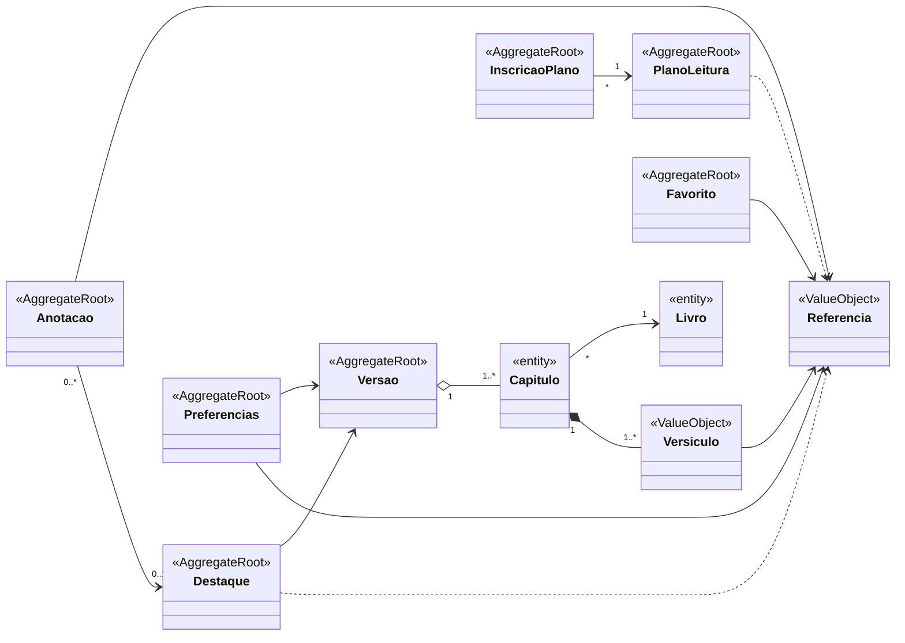
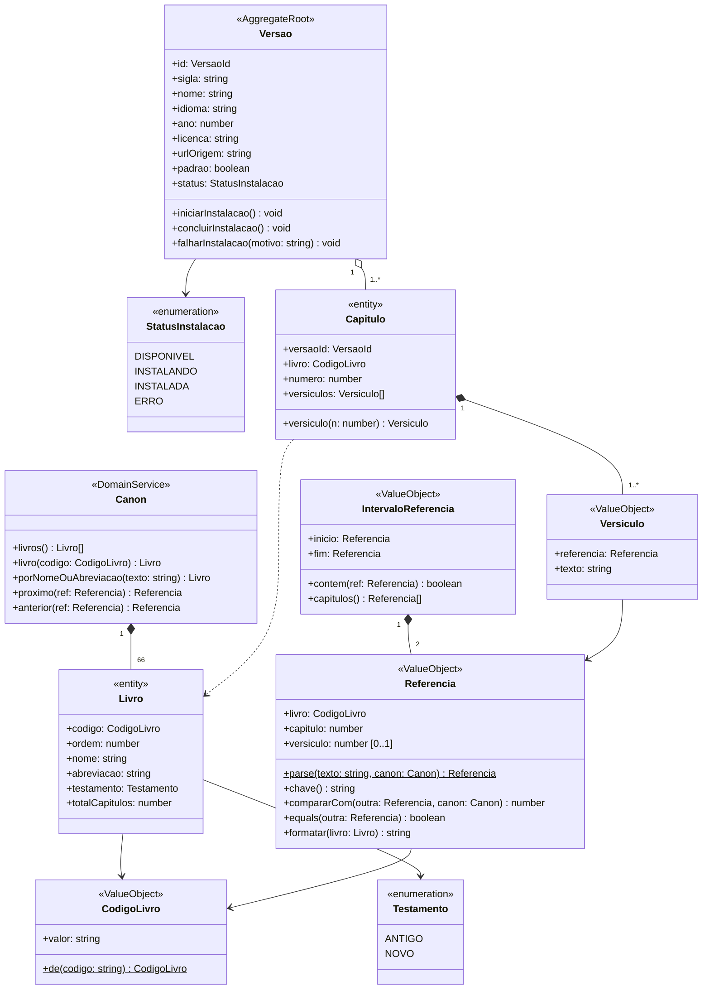
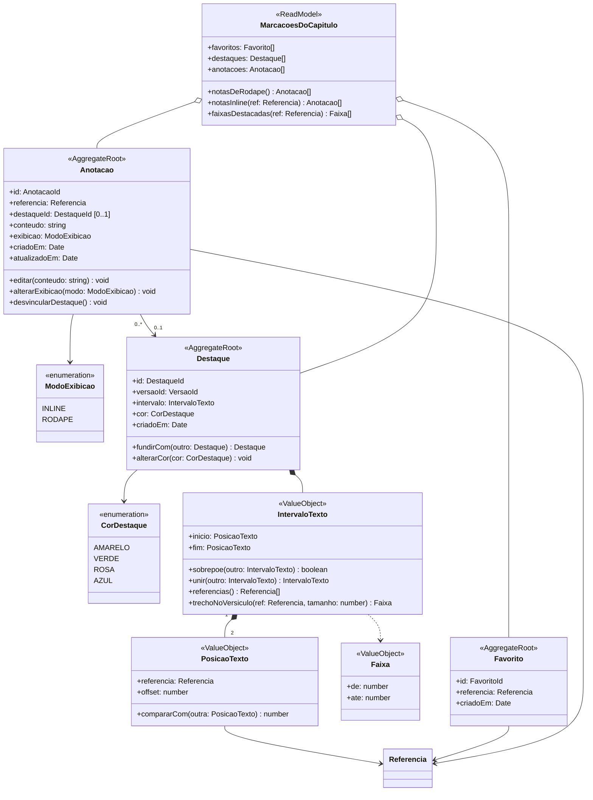
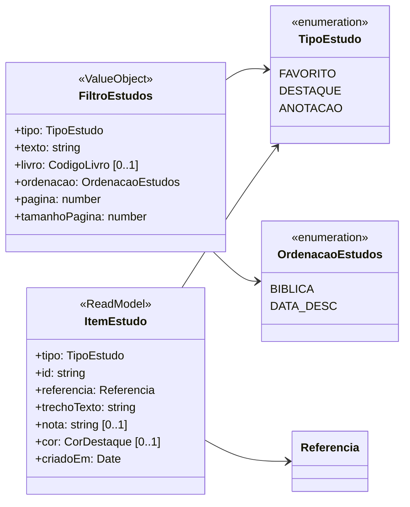
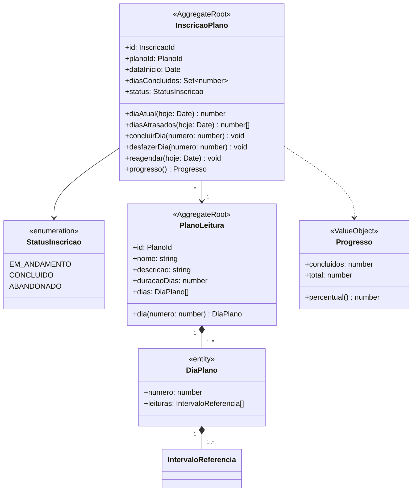
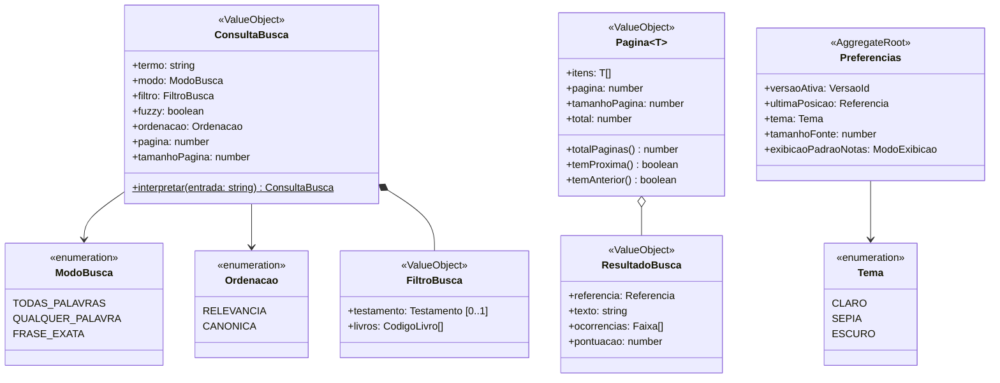

# 04 — Modelo de Domínio (Diagrama de Classes)

## 1. Abordagem

- **DDD tático:** *Entities*, *Value Objects*, *Aggregates* e *Repositories*.
- **Linguagem ubíqua em português** nos conceitos de domínio.
- O domínio **não depende** de React, Dexie ou MiniSearch; estes ficam na infraestrutura e implementam as **portas** (interfaces).
- Identificadores: `UUID v7` gerados no cliente (ordenáveis por tempo), tipados como *branded types* (`FavoritoId`, `DestaqueId`…).

### Módulos (bounded contexts)

| Módulo | Responsabilidade |
|---|---|
| `biblia` | Cânon, versões, texto bíblico, referências |
| `estudo` | Favoritos, destaques, anotações |
| `planos` | Planos de leitura e progresso |
| `busca` | Consulta e resultados paginados |
| `preferencias` | Posição de leitura, versão ativa, tema |

## 2. Visão geral

## 3. Módulo `biblia`

**Notas**
- `Livro` é **canônico** (66 livros, mesmos códigos USFM do `biblia.data`: `GEN`, `JHN`…) e independe da versão.
- `Referencia.chave()` gera a chave de persistência, ex.: `JHN.3.16`.
- `Referencia.parse()` aceita `Jo 3:16`, `João 3.16`, `jo 3`, `1 Co 13` etc.

## 4. Módulo `estudo`

**Invariantes**
- `IntervaloTexto`: `inicio ≤ fim`; offsets ≥ 0 e dentro do tamanho do versículo.
- `Anotacao.conteudo` não pode ser vazio.
- Um versículo tem **no máximo um** `Favorito`.
- `Destaque` pertence a uma versão (offsets dependem do texto); `Favorito` e `Anotacao` são **independentes de versão**.
- `MarcacoesDoCapitulo` é um *read model* montado para a renderização de um capítulo (não é persistido).

### 4.1 Consulta "Meus Estudos"

- `ConsultarMeusEstudos` retorna `Pagina<ItemEstudo>`; filtro e ordenação são feitos em memória (volume de dados do usuário é pequeno e local).

## 5. Módulo `planos`

**Invariantes**
- `concluirDia(n)`: `1 ≤ n ≤ duracaoDias`; ao concluir todos → `status = CONCLUIDO`.
- `diaAtual(hoje)` é limitado a `[1, duracaoDias]`.
- Planos pré-definidos são dados estáticos (JSON versionado no repositório).

## 6. Módulos `busca` e `preferencias`

- `ConsultaBusca.interpretar('"amor de Deus"')` → `FRASE_EXATA`; sem aspas → `TODAS_PALAVRAS`.

## 7. Portas (interfaces) e Casos de Uso — camada de aplicação

```mermaid
classDiagram
    direction LR

    class VersaoRepository {
        <<interface>>
        +listar() Promise~Versao[]~
        +obter(id: VersaoId) Promise~Versao~
        +salvar(v: Versao) Promise~void~
        +remover(id: VersaoId) Promise~void~
    }
    class TextoBiblicoRepository {
        <<interface>>
        +obterCapitulo(v: VersaoId, l: CodigoLivro, n: number) Promise~Capitulo~
        +obterVersiculos(v: VersaoId, refs: Referencia[]) Promise~Versiculo[]~
        +importar(v: VersaoId, livros: LivroImportado[]) Promise~void~
        +removerVersao(v: VersaoId) Promise~void~
    }
    class FavoritoRepository {
        <<interface>>
        +porCapitulo(capitulo: Referencia) Promise~Favorito[]~
        +porReferencia(versiculo: Referencia) Promise~Favorito~
        +listar() Promise~Favorito[]~
        +salvar(f: Favorito) Promise~void~
        +remover(id: FavoritoId) Promise~void~
    }
    class DestaqueRepository {
        <<interface>>
        +porCapitulo(v: VersaoId, l: CodigoLivro, n: number) Promise~Destaque[]~
        +listar() Promise~Destaque[]~
        +salvar(d: Destaque) Promise~void~
        +remover(id: DestaqueId) Promise~void~
    }
    class AnotacaoRepository {
        <<interface>>
        +porCapitulo(l: CodigoLivro, n: number) Promise~Anotacao[]~
        +listar() Promise~Anotacao[]~
        +salvar(a: Anotacao) Promise~void~
        +remover(id: AnotacaoId) Promise~void~
    }
    class PlanoRepository {
        <<interface>>
        +listar() Promise~PlanoLeitura[]~
        +obter(id: PlanoId) Promise~PlanoLeitura~
    }
    class InscricaoRepository {
        <<interface>>
        +ativas() Promise~InscricaoPlano[]~
        +salvar(i: InscricaoPlano) Promise~void~
    }
    class PreferenciasRepository {
        <<interface>>
        +obter() Promise~Preferencias~
        +salvar(p: Preferencias) Promise~void~
    }
    class ServicoBusca {
        <<interface>>
        +indexar(v: VersaoId, progresso: Callback) Promise~void~
        +buscar(v: VersaoId, c: ConsultaBusca) Promise~Pagina~
    }
    class FonteVersoes {
        <<interface>>
        +catalogo() Promise~Versao[]~
        +baixar(v: VersaoId, progresso: Callback) Promise~LivroImportado[]~
    }
    class Relogio {
        <<interface>>
        +agora() Date
    }

    class GeradorId {
        <<interface>>
        +novo() string
    }

    class AbrirCapitulo {
        <<UseCase>>
        +executar(ref: Referencia) Promise~CapituloAberto~
    }
    class BuscarTexto {
        <<UseCase>>
        +executar(c: ConsultaBusca) Promise~Pagina~
    }
    class AlternarFavorito {
        <<UseCase>>
        +executar(ref: Referencia) Promise~boolean~
    }
    class ObterMarcacoesDoCapitulo {
        <<UseCase>>
        +executar(ref: Referencia) Promise~MarcacoesDoCapitulo~
    }
    class MarcarTexto {
        <<UseCase>>
        +executar(i: IntervaloTexto, cor: CorDestaque) Promise~Destaque~
    }
    class SalvarAnotacao {
        <<UseCase>>
        +executar(dados: AnotacaoDTO) Promise~Anotacao~
    }
    class IniciarPlano {
        <<UseCase>>
        +executar(p: PlanoId) Promise~InscricaoPlano~
    }
    class ConcluirDiaPlano {
        <<UseCase>>
        +executar(i: InscricaoId, dia: number) Promise~void~
    }
    class InstalarVersao {
        <<UseCase>>
        +executar(v: VersaoId) Promise~void~
    }
    class ConsultarMeusEstudos {
        <<UseCase>>
        +executar(f: FiltroEstudos) Promise~Pagina~
    }
    class ExportarDados {
        <<UseCase>>
        +executar() Promise~Backup~
    }
    class ImportarDados {
        <<UseCase>>
        +executar(b: Backup) Promise~void~
    }

    AbrirCapitulo ..> TextoBiblicoRepository
    AbrirCapitulo ..> PreferenciasRepository
    BuscarTexto ..> ServicoBusca
    AlternarFavorito ..> FavoritoRepository
    AlternarFavorito ..> Relogio
    AlternarFavorito ..> GeradorId
    ObterMarcacoesDoCapitulo ..> FavoritoRepository
    ObterMarcacoesDoCapitulo ..> DestaqueRepository
    ObterMarcacoesDoCapitulo ..> AnotacaoRepository
    MarcarTexto ..> DestaqueRepository
    SalvarAnotacao ..> AnotacaoRepository
    IniciarPlano ..> PlanoRepository
    IniciarPlano ..> InscricaoRepository
    IniciarPlano ..> Relogio
    ConcluirDiaPlano ..> InscricaoRepository
    InstalarVersao ..> FonteVersoes
    InstalarVersao ..> VersaoRepository
    InstalarVersao ..> TextoBiblicoRepository
    InstalarVersao ..> ServicoBusca
    ConsultarMeusEstudos ..> FavoritoRepository
    ConsultarMeusEstudos ..> DestaqueRepository
    ConsultarMeusEstudos ..> AnotacaoRepository
    ConsultarMeusEstudos ..> TextoBiblicoRepository
    ExportarDados ..> FavoritoRepository
    ExportarDados ..> DestaqueRepository
    ExportarDados ..> AnotacaoRepository
    ExportarDados ..> InscricaoRepository
    ImportarDados ..> FavoritoRepository
    ImportarDados ..> DestaqueRepository
    ImportarDados ..> AnotacaoRepository
    ImportarDados ..> InscricaoRepository
```

**Notas de implementação (fase 7.1)**
- `AbrirCapitulo` retorna, por ora, `CapituloAberto` (capítulo, livro, `anterior`/`proximo` e `versiculoEmFoco`); favoritos, destaques e anotações ficam em um caso de uso separado (revisto na fase 7.2, abaixo).
- `TextoBiblicoRepository` ganhou `possuiVersao()`; `importar()` é atômico.
- Porta adicional `FonteVersaoEmbarcada` (lê a BLIVRE de `public/dados`) e caso de uso `PrepararVersaoPadrao` (importação na primeira execução) e `ObterPosicaoInicial`.
- `Versao` ainda sem `StatusInstalacao` (entra com UC09); `Preferencias` só com `versaoAtiva` e `ultimaPosicao` (tema/fonte com UC12).
- `Referencia.deChave()` é o inverso de `chave()`; `Referencia.doCapitulo()` descarta o versículo.

**Notas de implementação (fase 7.2)**
- **Marcações separadas do texto:** `AbrirCapitulo` continua devolvendo `CapituloAberto` (texto + navegação) e salvando a posição; as marcações vêm de `ObterMarcacoesDoCapitulo` → `MarcacoesDoCapitulo`. Assim, favoritar recarrega só as marcações, sem reler o texto nem regravar a posição (ver docs/06 §5.1). Nesta fase `MarcacoesDoCapitulo` tem só `favoritos` e `favoritado(n)`; destaques e anotações entram em 7.3/7.4.
- `FavoritoRepository` recebe `Referencia` (como `TextoBiblicoRepository`) e ganhou `porReferencia()` para o `AlternarFavorito`; `listar()` entra com UC13 (fase 7.6).
- `AlternarFavorito` devolve o novo estado (`true` = favoritado), usado no aviso ao leitor de tela.
- `Favorito.criar()` exige referência de **versículo**; `FavoritoId` valida o formato UUID.
- `Relogio` expõe `agora()` (o "hoje" dos planos deriva dele); nova porta `GeradorId` (UUID v7 gerado fora do domínio, que não usa bibliotecas externas — ADR 0006).

### Adapters (infraestrutura) previstos

| Porta | Implementação |
|---|---|
| `*Repository` | `Dexie*Repository` (IndexedDB) |
| `FonteVersaoEmbarcada` | `FonteEstatica` (`public/dados/<SIGLA>/<LIVRO>.json`, em precache) |
| `ServicoBusca` | `MiniSearchServicoBusca` (executa em Web Worker; índice persistido no IndexedDB) |
| `FonteVersoes` | `GitHubBibliaDataFonte` (baixa `data/canonical/<SIGLA>/<LIVRO>.json`) |
| `PlanoRepository` | `PlanosEstaticosRepository` (JSON empacotado no build) |
| `Relogio` | `RelogioSistema` (testes usam `RelogioFixo`) |
| `GeradorId` | `GeradorUuidV7` (biblioteca `uuid`; testes usam `GeradorIdSequencial`) |

## 8. Mapeamento com a fonte de dados

| `biblia.data` (JSON) | Domínio |
|---|---|
| arquivo `data/canonical/BLIVRE/JHN.json` | `Versao(sigla=BLIVRE)` + `Livro(codigo=JHN)` |
| `id` | `Livro.ordem` |
| `code` | `Livro.codigo` |
| `name`, `abbrev` | `Livro.nome`, `Livro.abreviacao` |
| `chapters[].number` | `Capitulo.numero` |
| `chapters[].verses[].number`, `.text` | `Versiculo.referencia.versiculo`, `Versiculo.texto` |
