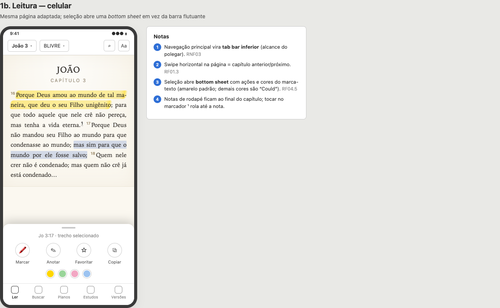
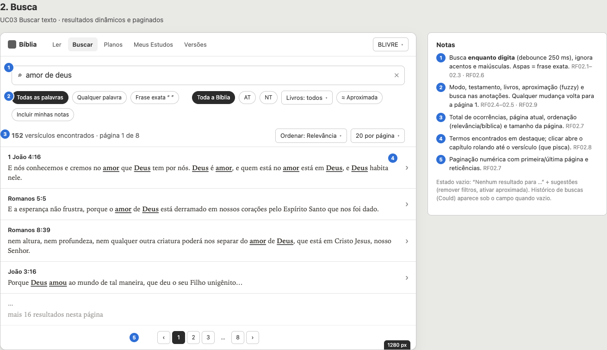
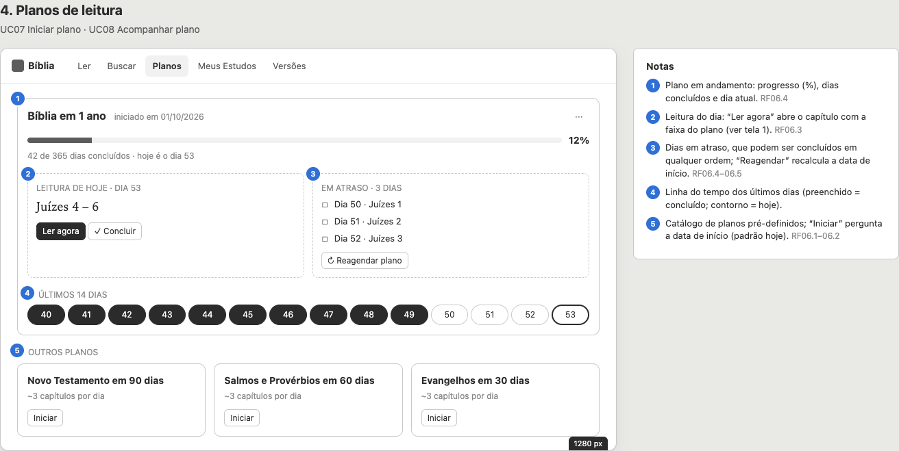
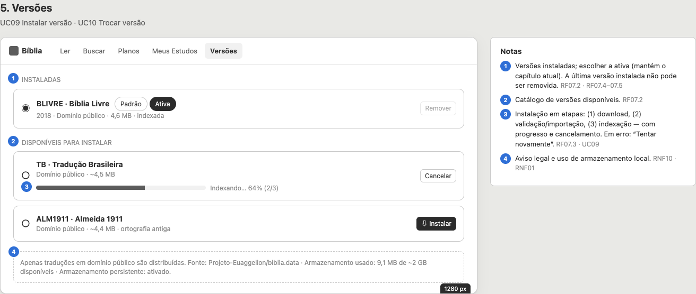
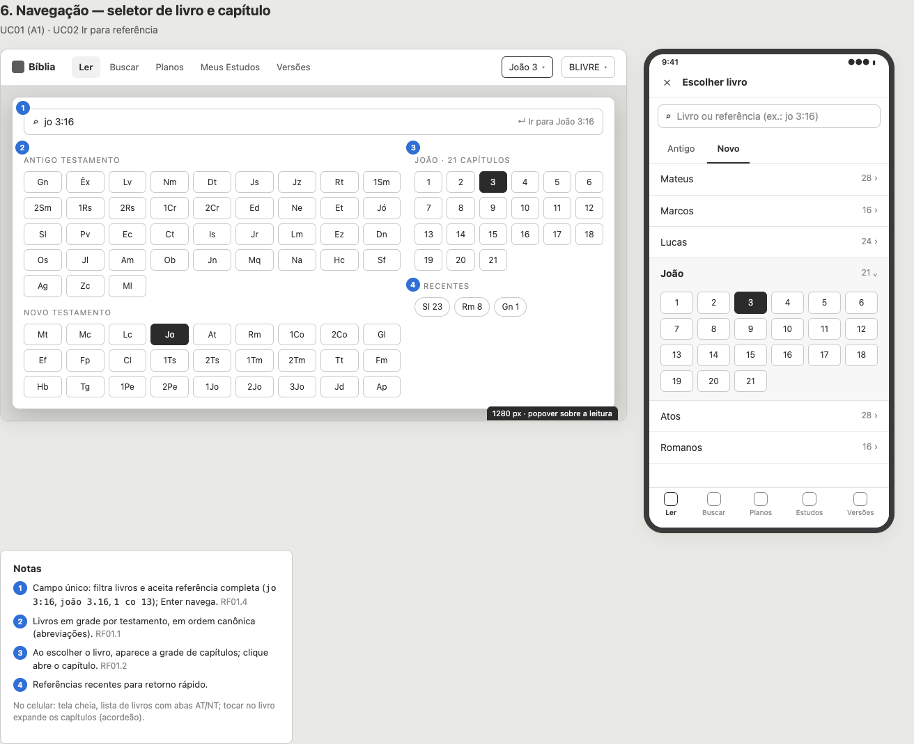

# 05 — Wireframes

| Campo | Valor |
|---|---|
| Versão | 0.1 (rascunho) |
| Data | 2026-11-22 |
| Fidelidade | Baixa/média — estrutura, hierarquia e comportamento |
| Status | Em revisão |

> **Fonte:** [`index.html`](index.html) (abra localmente no navegador para ver interativo).
> As imagens abaixo são capturas da página, geradas para visualização no GitHub.
> Os círculos azuis numerados remetem às notas de cada tela (com rastreabilidade para RF/UC).

## Navegação principal

`Ler · Buscar · Planos · Meus Estudos · Versões` — barra superior no desktop, *tab bar* inferior no celular.

## 1. Leitura — desktop
UC01 · UC04 · UC05 · UC06 — página de papel, marca-texto, favoritos, notas inline e de rodapé, barra flutuante de seleção.

> **Implementado na fase 7.2 (UC04):** favoritar não depende de selecionar texto. O **número do versículo** é um botão que abre uma **barra de ações do versículo** fixa no rodapé (desktop e celular), acessível pelo teclado. A barra flutuante de seleção do wireframe continua prevista para o marca-texto (UC05, fase 7.3).

> **Implementado na fase 7.3 (UC05):** a barra de seleção também fica **fixa no rodapé** em vez de flutuar junto ao trecho: no celular, o menu nativo de seleção (Copiar…) aparece sobre o texto e cobriria uma barra flutuante. Ela mostra **Marcar** e as quatro cores (um toque marca na cor), mais **Desmarcar** quando a seleção cobre um destaque. Tocar num trecho marcado abre a barra do destaque (cores e Remover).

> **Implementado na fase 7.4 (UC06):** **Anotar** fica na barra do versículo e na barra do destaque (não na barra de seleção). O editor é um diálogo modal, *bottom sheet* no celular. As notas de rodapé têm marcador numerado no fim do versículo (ou do trecho destacado) e ficam no pé da página, com **Voltar ao texto**; as inline são um bloco após o versículo, que divide o texto em parágrafos, como no wireframe.

## 1b. Leitura — celular
Seleção abre *bottom sheet* com ações e cores.

## 2. Busca
UC03 — busca dinâmica, modos, filtros, resultados paginados.

> **Implementado na fase 7.5 (UC03):** como no wireframe, com estas diferenças: o total é de **versículos**; "Incluir minhas notas" (RF02.9) fica para Meus Estudos (7.6); a paginação mostra primeira, última e as vizinhas da atual. Sem resultados, os botões de sugestão (aproximada, toda a Bíblia, qualquer ordem) aparecem abaixo da mensagem. O estado da busca fica na URL.

## 3. Meus Estudos
UC13 — abas Favoritos / Destaques / Anotações, filtro, ordenação, paginação.

## 4. Planos de leitura
UC07 · UC08 — progresso, leitura do dia, atrasos, reagendamento, catálogo.

## 5. Versões
UC09 · UC10 — instaladas, disponíveis, progresso de instalação.

## 6. Navegação — seletor de livro e capítulo
UC01 (A1) · UC02 — desktop (popover) e celular (tela cheia com acordeão).

