# 06 — Arquitetura

| Campo | Valor |
|---|---|
| Versão | 0.1 (rascunho) |
| Data | 2026-11-22 |
| Status | Em revisão |
| Decisões | [ADRs](adr/README.md) |

## 1. Visão geral

Aplicação **cliente pura** (SPA + PWA), sem backend. Todo o processamento e armazenamento acontece no navegador. A organização interna segue a **Arquitetura Hexagonal (Ports & Adapters)**: o domínio não conhece React, IndexedDB nem MiniSearch.

Diagramas no estilo **[C4 Model](https://c4model.com)** (Contexto → Containers → Componentes), desenhados com `flowchart` Mermaid.

## 2. C4 — Nível 1: Contexto

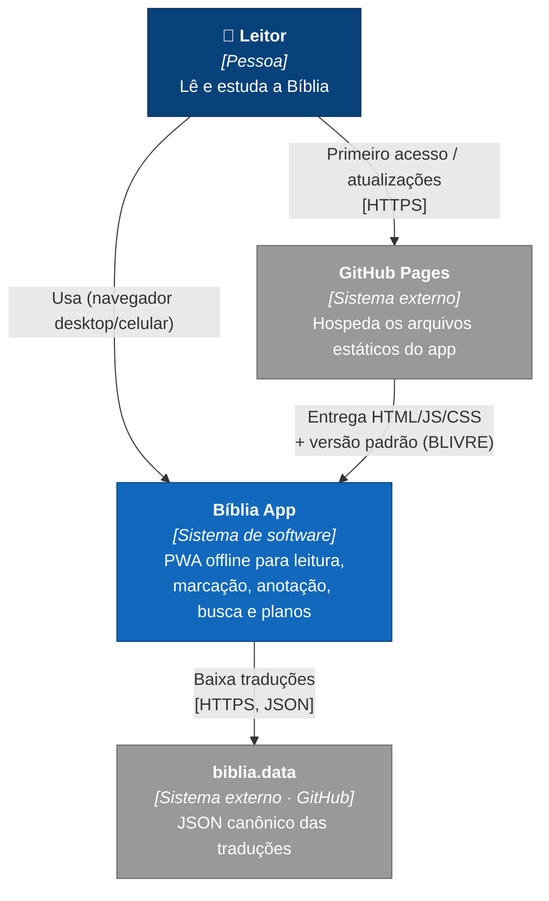

## 3. C4 — Nível 2: Containers

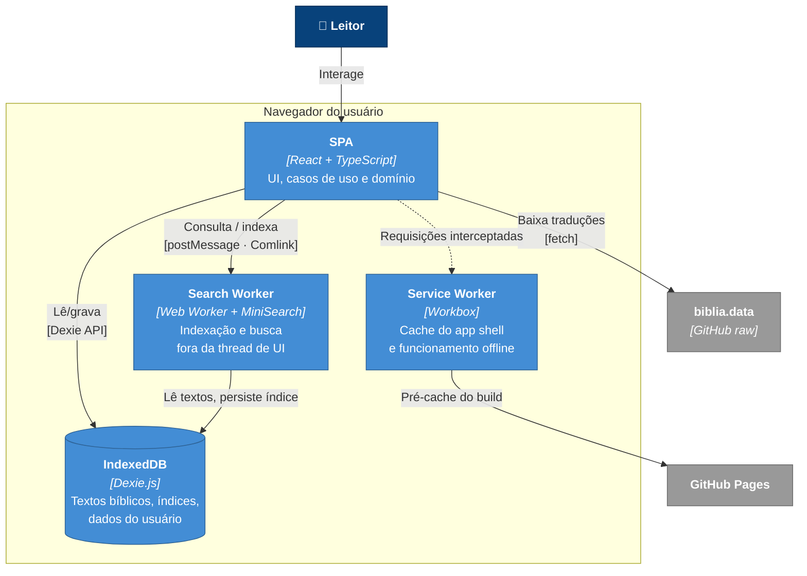

| Container | Tecnologia | Responsabilidade |
|---|---|---|
| SPA | React 19, TypeScript, Vite, Tailwind | Interface, roteamento, casos de uso, domínio |
| Service Worker | `vite-plugin-pwa` (Workbox) | Pré-cache do app, offline, atualização da versão do app |
| Search Worker | Web Worker, MiniSearch, Comlink | Construção e consulta do índice full-text |
| IndexedDB | Dexie.js | Persistência local de todos os dados |

## 4. C4 — Nível 3: Componentes (SPA)

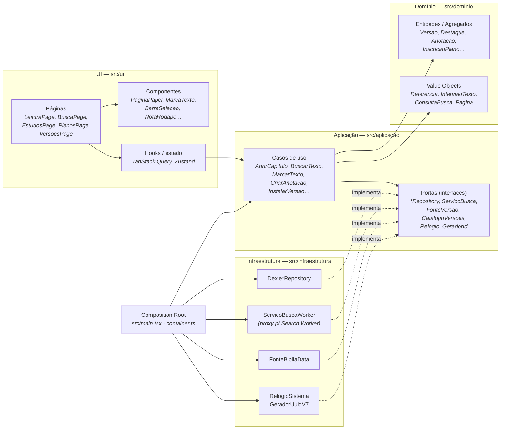

### Regra de dependência

```
ui  ──►  aplicacao  ──►  dominio
              ▲
infraestrutura ┘   (implementa as portas da aplicação)
```

- `dominio` **não importa nada** de outras camadas nem de bibliotecas de terceiros (exceto utilitários puros).
- `aplicacao` importa apenas `dominio`.
- `infraestrutura` importa `aplicacao` (portas) e `dominio`.
- `ui` importa `aplicacao` (casos de uso, DTOs) e `dominio` (tipos/value objects para exibição).
- A regra é **verificada automaticamente** no CI com `eslint-plugin-boundaries` (ou `dependency-cruiser`).
- A injeção de dependências é feita manualmente no **Composition Root** (sem framework de DI).

## 5. Diagramas de sequência

### 5.1 Abrir capítulo (UC01) e favoritar (UC04)

Texto e marcações são **duas leituras independentes** (decisão da fase 7.2): `AbrirCapitulo` lê o texto e salva a posição; `ObterMarcacoesDoCapitulo` lê favoritos, destaques e anotações. Uma alteração de marcação invalida só a consulta de marcações no cache do TanStack Query, sem reler o texto nem regravar a posição.

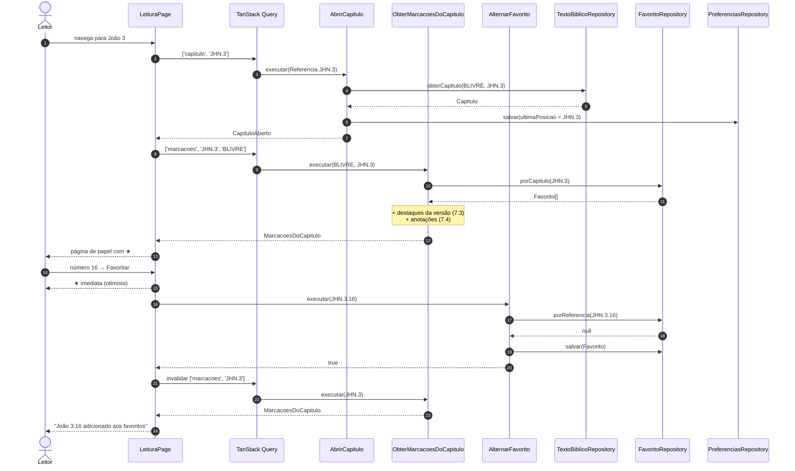

**Navegação** (`BarraSuperior`): Ler, Buscar, Planos, Meus Estudos e Versões (7.8). No desktop, links na barra superior; no celular (< 640 px), o mesmo `<nav>` vira uma *tab bar* fixa no rodapé (fase 7.7), como no wireframe. A variável CSS `--base-inferior` diz onde começa o espaço livre no pé da tela, e as barras fixas da leitura ficam acima da tab bar. Um teste E2E confere que nenhuma tela fica mais larga que a janela.

**TanStack Query** (`src/ui/consultas/clienteConsultas.ts`): `networkMode: 'always'` (os dados são locais; o padrão pausaria consultas offline), `staleTime: Infinity` (só mudam pelas mutações, que invalidam o cache), sem *retry*. A consulta do capítulo usa `staleTime: 0`: ao voltar a um capítulo em cache, a página aparece na hora e `AbrirCapitulo` roda em segundo plano para registrar a posição.

### 5.2 Marcar texto (UC05)

A seleção é convertida em `IntervaloTexto` na UI (`selecaoTexto.ts`): os offsets contam só o texto dos versículos (cada um num elemento `data-texto-versiculo`), ignorando o número e o espaço entre versículos. As regras ficam no domínio: `TextoDoCapitulo` ajusta a palavras inteiras e `SobreposicaoDestaques` funde (mesma cor) ou corta (outra cor). O repositório grava tudo numa transação.

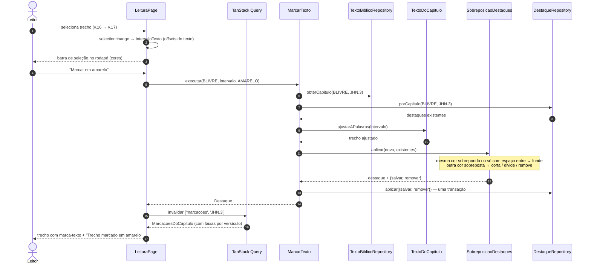

Sem atualização otimista (ao contrário do favorito): o resultado (fusões e cortes) só é conhecido depois das regras, e a gravação é local e rápida. Tocar num `<mark>` abre a barra do destaque (trocar cor → `AlterarCorDestaque`, remover → `RemoverDestaque`); a borracha usa `DesmarcarTexto`. Na fusão, `aplicar()` também religa as anotações do destaque removido ao sobrevivente (`religar`), na mesma transação sobre `destaques` + `anotacoes`.

### 5.3 Anotar (UC06)

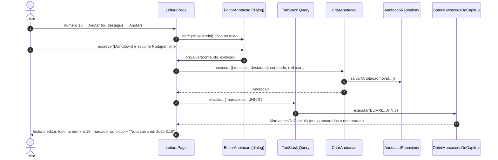

A página é dividida em parágrafos após cada versículo com nota inline. O marcador de rodapé é um botão cujo número vem do CSS (`::before { content: attr(data-n) }`), para não entrar nos offsets da seleção do marca-texto. O Markdown é convertido em elementos React por um parser próprio (`markdown.tsx`), sem `innerHTML`. O foco volta ao versículo só depois que o `<dialog>` desmonta: com o modal aberto, o resto da página é inerte.

### 5.4 Buscar texto (UC03)

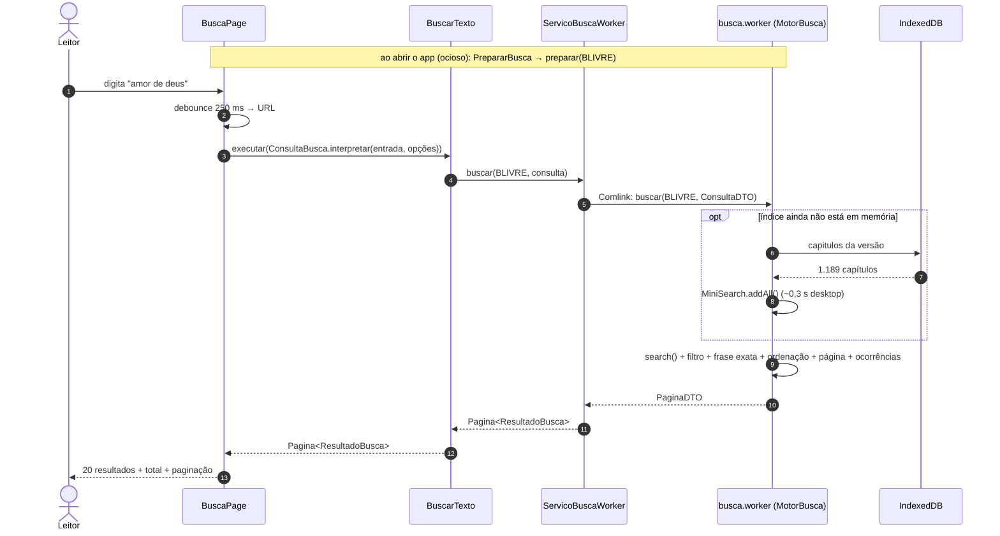

Consulta e página atravessam o `postMessage` como DTOs (`dto.ts`), pois o *structured clone* não preserva classes. Medido no navegador (fase 7.5): ~25–35 ms por busca com o índice pronto (ida e volta ao worker incluída; meta RNF02: < 500 ms) e ~1,3 s para a primeira busca logo após abrir o app, que mostra "Preparando a busca…".

### 5.5 Consultar Meus Estudos (UC13)

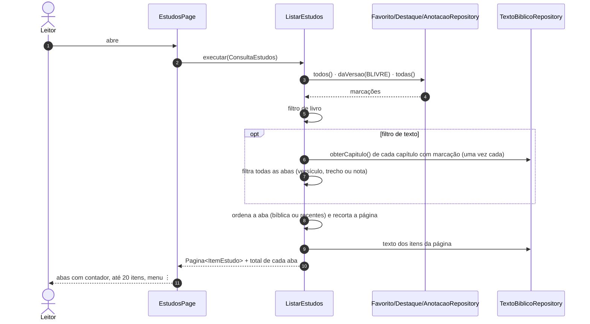

Os dados do leitor são poucos (centenas de marcações), então filtro, ordem e paginação rodam em memória na camada de aplicação, sem índices novos (o schema continua na v4). O texto bíblico só é lido para o filtro de texto ou para os itens da página. Os totais das abas seguem os filtros. As ações do menu ⋮ reaproveitam os casos de uso da leitura (`AlterarCorDestaque`, `RemoverDestaque`, `EditarAnotacao`, `ExcluirAnotacao`), mais `RemoverFavorito`. Toda mutação de marcação invalida as marcações do capítulo **e** as listas de Meus Estudos (`invalidarMarcacoes`), pois as duas telas mostram os mesmos dados. O estado da tela fica na URL, como na busca. A busca das anotações (RF02.9) é o filtro de texto da aba Anotações; a tela de busca tem um link que leva o termo para lá.

### 5.6 Acompanhar plano (UC08)

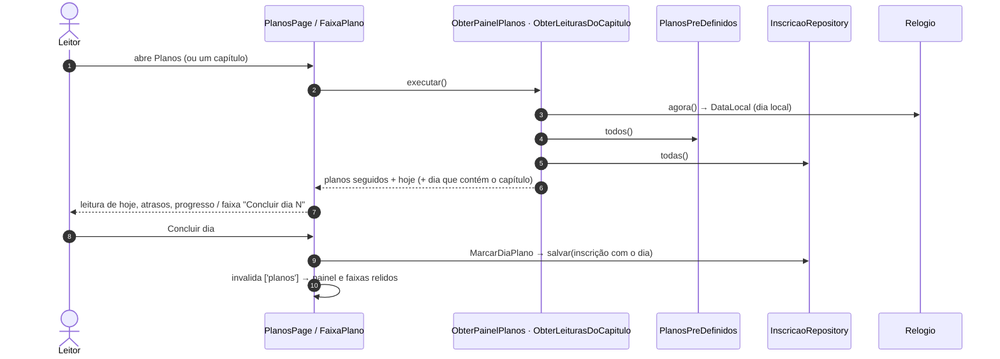

As consultas de planos usam `staleTime: 0` e `refetchOnWindowFocus` (ao contrário do padrão do app): dependem do dia de hoje, que muda com o app aberto ou ao voltar a ele.

### 5.7 Instalar versão (UC09)

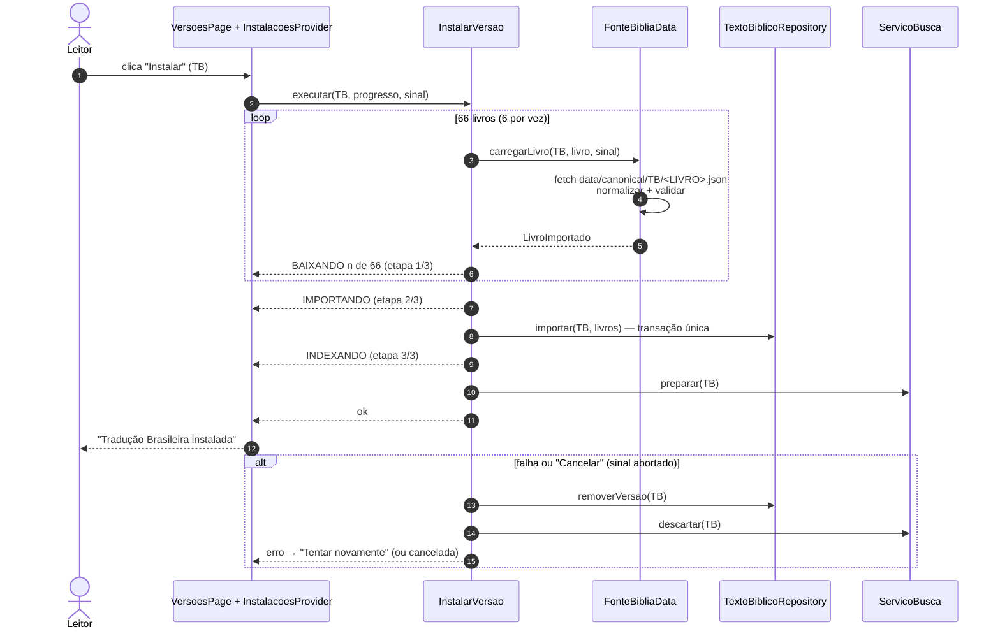

O andamento fica no `InstalacoesProvider`, acima das rotas: sair da tela Versões não interrompe a instalação. Trocar a versão ativa (UC10) grava as preferências e relê todo o cache do TanStack Query, porque texto, busca, destaques e Meus Estudos dependem da versão.

### 5.8 Importar backup (UC11)

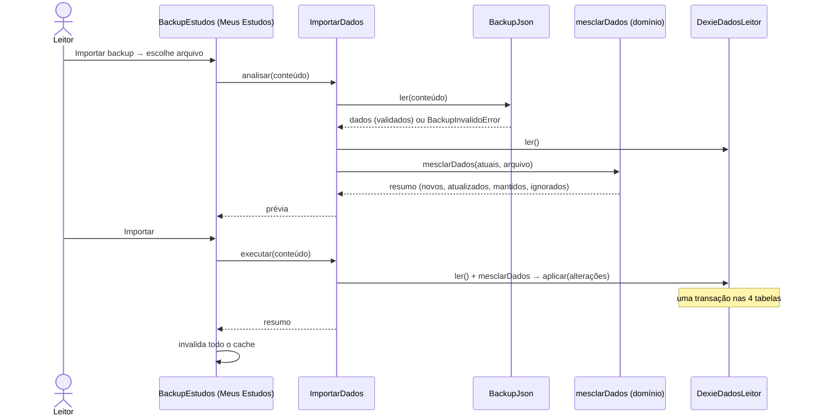

### 5.9 Tema, tamanho da fonte e largura da página (UC12)

O tema muda as **variáveis de cor** do Tailwind v4 (`--color-stone-*`, `--color-white`, `--color-red-*`… e os tokens `papel`, `tinta`, `primaria`) em `:root[data-tema='SEPIA' | 'ESCURO']` (`index.css`); as telas não mudam de classe. Texto sobre fundo sólido usa o token `sobre-tinta` (branco; escuro no tema escuro). No escuro, o marca-texto troca `multiply` por cores mais fechadas. O tamanho é a variável `--escala-leitura` (níveis 1–7 → 0,8 a 1,6) sobre o tamanho base do `.texto-biblico`. A largura da página (BL-01) é o atributo `data-largura` (`ESTREITA`, `MEDIA`, `LARGA`): regras de `index.css` fora das camadas do Tailwind, só em `width >= 48rem`, trocam o `max-width` e o `padding-inline` da `.pagina-papel` (48rem/4,5rem e 56rem/5,5rem); a Estreita é o `max-w-2xl` do componente.

`AplicarTema` (no topo do `App`) lê a configuração (`ConfigurarLeitura.obter`) e põe `data-tema`, `data-largura` e `--escala-leitura` no `<html>`, atualiza a `meta theme-color` e guarda uma cópia no `localStorage`. Um script curto (`public/tema-inicial.js`, carregado no `<head>`; fora do HTML por causa da CSP) aplica essa cópia antes de o React carregar, para o tema escuro não piscar claro nem a página pular de largura na abertura. A fonte da verdade continua sendo o IndexedDB.

## 6. Persistência (IndexedDB / Dexie)

| Store | Chave primária | Índices | Conteúdo |
|---|---|---|---|
| `versoes` | `id` | `status` | Metadados de `Versao` |
| `capitulos` | `[versaoId+livro+numero]` | `versaoId` | `Capitulo` com array de versículos |
| `favoritos` | `id` | `&chave` (`JHN.3.16`), `[livro+capitulo]`, `criadoEm` | `Favorito` |
| `destaques` | `id` | `[versaoId+livro+capitulo]`, `criadoEm` | `Destaque` |
| `anotacoes` | `id` | `[livro+capitulo]`, `atualizadoEm`, `destaqueId` | `Anotacao` |
| `inscricoes` | `id` | `&planoId` | `InscricaoPlano` |
| `preferencias` | `id` (`'usuario'`) | — | `Preferencias` |

- **Granularidade por capítulo**: abrir um capítulo = 1 leitura (atende RNF02 < 300 ms).
- **Migrações** versionadas com `db.version(n).stores(...).upgrade(...)`.
- **Persistência durável** (BL-05, fase 7.9): ao abrir, se o armazenamento ainda não é persistente, o app chama `navigator.storage.persist()` (em `main.tsx`). O navegador decide: o Chrome concede pelo uso do site, o Firefox pode perguntar uma vez, o Safari ignora. Sem a API, nada muda. O backup (UC11) continua sendo a garantia de verdade.
- **Schema v1** (fase 7.1): `capitulos`, `versoes` (presença = versão importada por completo) e `preferencias`. Os demais stores entram em novas versões do schema.
- **Schema v2** (fase 7.2): `favoritos` (`id, &chave, [livro+capitulo], criadoEm`). Só cria a tabela; testado com migração a partir de um banco v1.
- **Schema v3** (fase 7.3): `destaques` (`id, [versaoId+livro+capitulo], criadoEm`); `inicio`/`fim` gravados como `[versículo, offset]`. Só cria a tabela; testado com migração a partir de um banco v2.
- **Schema v4** (fase 7.4): `anotacoes` (`id, [livro+capitulo], atualizadoEm, destaqueId`); o índice `destaqueId` serve para religar notas na fusão de destaques. Só cria a tabela; testado com migração a partir de um banco v3.
- **Fase 7.8:** sem mudança de schema. Uma versão instalada é a presença do registro em `versoes` (gravado na mesma transação dos capítulos); remover apaga os capítulos e o registro juntos. Destaques de uma versão removida ficam no banco.
- **Schema v5** (fase 7.7): `inscricoes` (`id, &planoId`); `inicio` gravado como `AAAA-MM-DD` (dia local), `diasConcluidos` como lista de números e `diaInicial` (UC07 A5; ausente = 1, sem índice). O índice único em `planoId` garante um plano por vez; o status é derivado, sem índice. Só cria a tabela; testado com migração a partir de um banco v4.
- **Fase 7.9:** sem mudança de schema. O registro de `preferencias` ganhou `tema` e `tamanhoFonte` opcionais (ausentes ou inválidos = configuração padrão, sem perder versão e posição).
- **BL-01:** sem mudança de schema. O registro de `preferencias` ganhou `largura` opcional (ausente = Estreita; inválida = configuração de leitura padrão).
- Mapeamento entidade ↔ registro feito por **mappers** na infraestrutura (o domínio não conhece o formato de armazenamento): `infraestrutura/dexie/mapeadores.ts` (fase 7.9), usados pelos repositórios, por `DexieDadosLeitor` e pelo arquivo de backup.

### 6.1 Arquivo de backup (UC11)

JSON gerado por `BackupJson` (formato 1), com os **mesmos registros do banco** e as datas em ISO 8601:

```json
{
  "app": "biblia-app",
  "formato": 1,
  "exportadoEm": "2026-11-24T12:00:00.000Z",
  "favoritos":  [{ "id": "…", "chave": "JHN.3.16", "livro": "JHN", "capitulo": 3, "criadoEm": "…" }],
  "destaques":  [{ "id": "…", "versaoId": "BLIVRE", "livro": "JHN", "capitulo": 3, "inicio": [16, 0], "fim": [16, 40], "cor": "AMARELO", "criadoEm": "…" }],
  "anotacoes":  [{ "id": "…", "chave": "JHN.3.16", "livro": "JHN", "capitulo": 3, "destaqueId": null, "conteudo": "…", "exibicao": "RODAPE", "criadoEm": "…", "atualizadoEm": "…" }],
  "inscricoes": [{ "id": "…", "planoId": "nt-90-dias", "totalDias": 90, "inicio": "2026-11-01", "diasConcluidos": [1, 2], "diaInicial": 1 }]
}
```

- `app` identifica o arquivo; `formato` muda só se o formato mudar de forma incompatível. Um formato maior que o conhecido é recusado ("atualize o app"); listas ausentes contam como vazias.
- Na leitura, cada item passa pelas regras do domínio; **um item inválido recusa o arquivo inteiro**, para não importar pela metade.
- **Limite de 20 MB** (BL-16): a tela recusa o arquivo antes de lê-lo, e `ImportarDados` confere de novo o tamanho do conteúdo antes de interpretar o JSON.
- A gravação (`DexieDadosLeitor.aplicar`) é uma transação nas quatro tabelas: tudo ou nada. Preferências e texto das versões não vão no arquivo.

## 7. Importação e normalização dos dados

### Versão embarcada (BLIVRE)

A BLIVRE é **pré-processada por script** e os arquivos gerados ficam **versionados** em `public/dados/BLIVRE/<LIVRO>.json` (entram no precache do PWA). O script roda manualmente, só quando a fonte muda — build e CI não dependem de rede:

```bash
npm run dados:blivre             # baixa do GitHub
npm run dados:blivre -- <dir>    # usa uma cópia local de data/canonical/BLIVRE
```

`scripts/dados/normalizar.ts` (funções puras, testadas) aplica a cada versículo:

1. normalização Unicode **NFC**;
2. remoção de markup de nota vazado (`/fn/…/*fn`, ex.: Dt 32:5);
3. `´` → `’` (`d´água`);
4. espaço após `, ; : . ! ? )` colado em letra (`destruição,diz`, `(Selá)Porque` — ~600 ocorrências);
5. `trim()` e colapso de espaços múltiplos (31 mil versículos tinham espaço final; 1,4 mil, espaço duplo).

E valida contra o cânon: código do livro, total de capítulos, capítulos sequenciais, versículos em ordem crescente e não vazios. A numeração dos versículos é **explícita** porque há lacunas (Sl 46 não tem o v. 3).

Formato embarcado (compacto, `capitulos[i]` = capítulo `i + 1`):

```json
{ "formato": 1, "livro": "JHN", "capitulos": [[[1, "No princípio era a Palavra, …"], [2, "…"]], …] }
```

Na primeira execução, `PrepararVersaoPadrao` carrega os 66 arquivos (`FonteEstatica`), valida e importa tudo numa **única transação** Dexie (tudo ou nada), com tela de progresso.

**Limitações conhecidas da fonte** (não corrigidas para não alterar o texto por heurística):
- algumas notas de tradução aparecem no corpo do versículo (ex.: 1Co 13:10 "…completo, Ou: perfeito…");
- Sl 46:3 está fundido ao v. 2.

### Versões instaláveis (UC09)

A **TB** e a **ALM1911** são baixadas no navegador pelo adapter `FonteBibliaData` (`raw.githubusercontent.com`, que responde com CORS liberado) e passam pela **mesma** normalização e validação da BLIVRE: o módulo `normalizar.ts` fica em `src/infraestrutura/fontes/` e o script da BLIVRE o importa de lá. JSON quebrado ou fora do cânon vira `VersaoCorrompidaError` (UC09 A2). O download é de ~6 MB por versão; o service worker não guarda essas respostas (o texto vai para o IndexedDB).

Verificação dos dados (fase 7.8): as duas versões têm os 66 livros, nenhum versículo vazio nem fora de ordem.
- **ALM1911:** 75 asteriscos da digitalização. A normalização junta palavras quebradas na linha ("arro-* *gantes" → "arrogantes"), mantém o hífen de nomes compostos ("Ben-*hadad" → "Ben-hadad") e tira os demais ("fru*ctos" → "fructos"). Erros de OCR em palavras (ex.: "co*uo" → "couo", Hb 12:27) não são corrigidos. A ortografia é a de 1911 ("fallando", "succedeu").
- **TB:** versículos de autenticidade discutida vêm entre colchetes (ex.: Mt 17:21), como na edição impressa; ficam como estão.
- **Numeração:** a BLIVRE tem 2Co 13:14 e Ap 12:18, que a TB e a ALM1911 não têm; Jó 42:17 falta na TB; Sl 46:3 existe na TB e na ALM1911 e falta na BLIVRE.

## 8. Estrutura de pastas

```
biblia-app/
├── .github/
│   ├── workflows/ci.yml          # lint, typecheck, testes, build
│   ├── workflows/deploy.yml      # GitHub Pages
│   └── pull_request_template.md
├── docs/                         # documentação (este diretório)
├── public/
│   └── dados/BLIVRE/             # versão embarcada (gerada por scripts/dados)
├── scripts/
│   └── dados/                    # preparar-blivre.ts (normalização em src/infraestrutura/fontes)
├── src/
│   ├── dominio/
│   │   ├── biblia/               # Versao, Livro, Capitulo, Referencia, Canon…
│   │   ├── estudo/               # Favorito, Destaque, Anotacao, IntervaloTexto…
│   │   ├── planos/               # PlanoLeitura, InscricaoPlano, Progresso…
│   │   ├── busca/                # ConsultaBusca, ResultadoBusca
│   │   ├── preferencias/
│   │   └── compartilhado/        # Pagina, Id, erros de domínio
│   ├── aplicacao/
│   │   ├── portas/               # *Repository, ServicoBusca, FonteVersao, CatalogoVersoes, Relogio
│   │   └── casos-de-uso/         # AbrirCapitulo, BuscarTexto, ListarEstudos, …
│   ├── infraestrutura/
│   │   ├── armazenamento/        # pedirArmazenamentoPersistente (BL-05)
│   │   ├── backup/               # BackupJson (UC11)
│   │   ├── dexie/                # BancoApp, Dexie*Repository, DexieDadosLeitor, mapeadores
│   │   ├── busca/                # MotorBusca, ServicoBuscaWorker, busca.worker.ts
│   │   ├── fontes/               # FonteEstatica (embarcada), FonteBibliaData, normalizar.ts
│   │   ├── versoes/              # VersoesDisponiveis (catálogo)
│   │   └── sistema/              # RelogioSistema
│   ├── ui/
│   │   ├── paginas/              # LeituraPage, BuscaPage, …
│   │   ├── componentes/          # PaginaPapel, MarcaTexto, …
│   │   ├── hooks/
│   │   ├── estilos/
│   │   └── rotas.ts              # caminhos das rotas (ADR 0009)
│   ├── container.ts              # Composition Root
│   └── main.tsx
├── tests/
│   ├── e2e/                      # Playwright
│   └── fixtures/
└── (testes unitários ficam ao lado do código: *.test.ts)
```

### Segurança (BL-16)

O app não tem servidor nem contas; as entradas externas são os **textos das versões** (biblia.data) e os **arquivos de backup**. As defesas:

- **Nada de HTML cru:** todo texto (versículos, notas em Markdown, nomes) vira elementos React; não há `innerHTML`/`dangerouslySetInnerHTML`. O Markdown das notas não tem links. Testes de UI conferem que HTML, `<script>` e `javascript:` vindos de uma versão ou de um backup aparecem como texto.
- **Validação pelo domínio:** cada item importado passa pelas mesmas regras do domínio (ids, referências, cores, datas, tamanhos); um campo inválido recusa o arquivo. Limite de 20 MB no backup.
- **Content-Security-Policy** por `<meta>` (o GitHub Pages não define cabeçalhos), injetada só no build por um plugin no `vite.config.ts`:

  ```
  default-src 'self'; script-src 'self'; worker-src 'self'; style-src 'self'; img-src 'self' data:;
  font-src 'self'; connect-src 'self' https://raw.githubusercontent.com; manifest-src 'self';
  object-src 'none'; base-uri 'self'; form-action 'self'
  ```

  Sem `unsafe-inline` nem `unsafe-eval`: o único script que era inline (tema inicial) virou arquivo. Os estilos dinâmicos do React usam o CSSOM, que a CSP permite. Um teste E2E percorre leitura, tema, favorito, busca (worker), instalação de versão e backup sem nenhuma violação, e confere que um script injetado é bloqueado. Por ser `<meta>`, `frame-ancestors` não se aplica.
- **CI e dependências:** ver docs/07 §6.

## 9. Estratégia de testes

| Nível | Ferramenta | Alvo | Meta |
|---|---|---|---|
| Unitário | Vitest | `dominio` e `aplicacao` (com repositórios em memória) | ≥ 80% de cobertura |
| Integração | Vitest + `fake-indexeddb` | Adapters Dexie e MiniSearch | Fluxos de persistência e busca |
| Componente | Testing Library | Componentes críticos (PaginaPapel, MarcaTexto) | Comportamento, acessibilidade |
| E2E | Playwright | Fluxos UC01, UC03, UC05, UC06, UC08, UC09 + offline | Caminhos principais |

## 10. Atributos de qualidade × decisões

| RNF | Como é atendido |
|---|---|
| RNF01 Offline | Service Worker (pré-cache) + IndexedDB + BLIVRE embarcada |
| RNF02 Desempenho | Capítulo como unidade de leitura; busca em Web Worker; índice persistido |
| RNF04 Acessibilidade | Componentes semânticos, foco visível, testes com `axe` no Playwright |
| RNF05 Privacidade | Sem backend, sem analytics; dados só no dispositivo |
| RNF06 Manutenibilidade | Hexagonal + regra de dependência verificada no CI |
| RNF07 Qualidade | CI obrigatório em PR: lint, typecheck, testes, cobertura |
| RNF09 Extensibilidade | Novas traduções = novo item no catálogo; sem alterar domínio |
