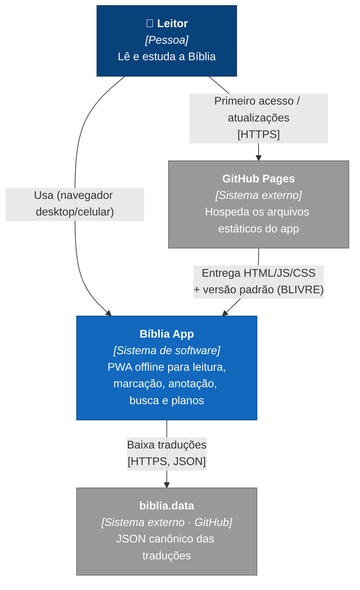
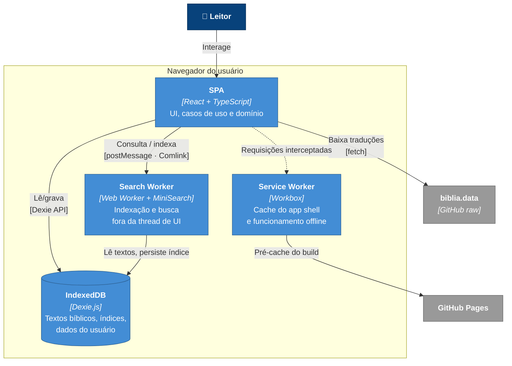
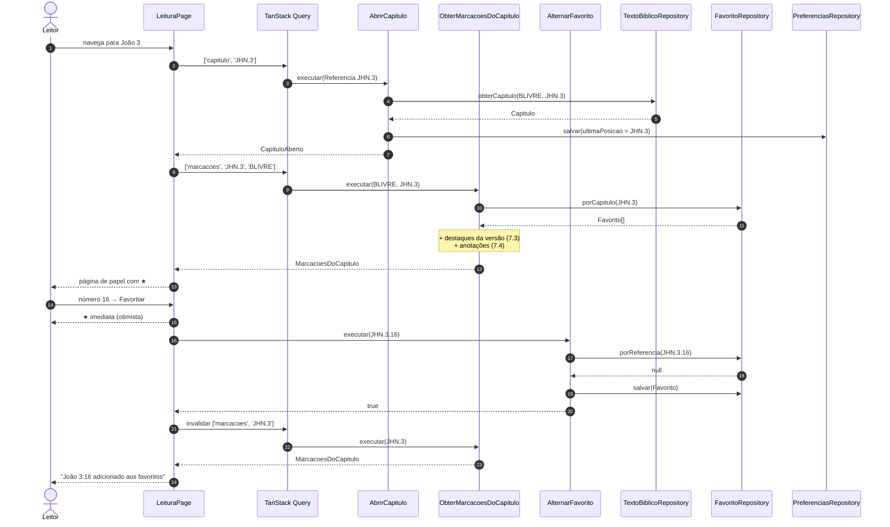
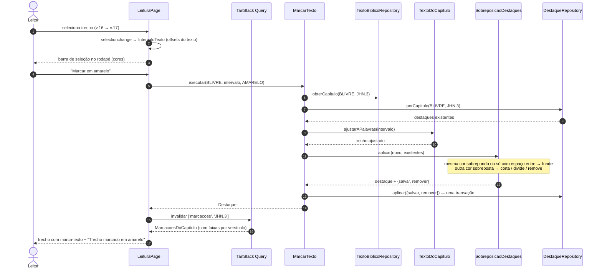
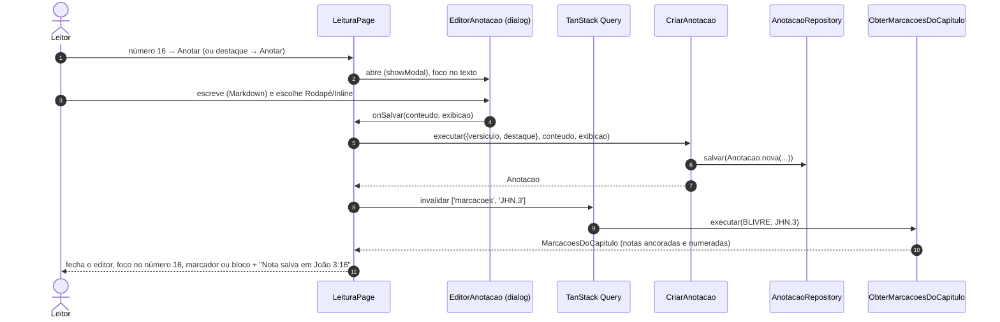
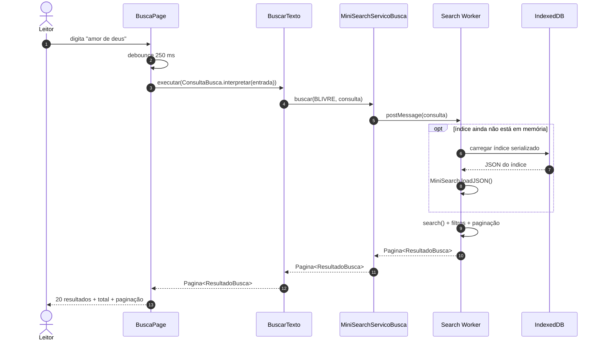
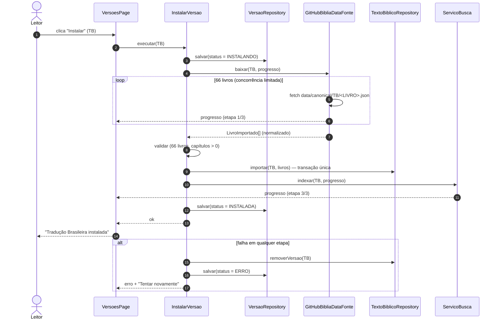

# 06 — Arquitetura

| Campo | Valor |
|---|---|
| Versão | 0.1 (rascunho) |
| Data | 2026-11-22 |
| Status | Em revisão |
| Decisões | [ADRs](adr/README.md) |

## 1. Visão geral

Aplicação **cliente pura** (SPA + PWA), sem backend. Todo o processamento e armazenamento acontece no navegador. A organização interna segue a **Arquitetura Hexagonal (Ports & Adapters)**: o domínio não conhece React, IndexedDB nem MiniSearch.

Diagramas no estilo **[C4 Model](https://c4model.com)** (Contexto → Containers → Componentes), desenhados com `flowchart` Mermaid.

## 2. C4 — Nível 1: Contexto



## 3. C4 — Nível 2: Containers



| Container | Tecnologia | Responsabilidade |
|---|---|---|
| SPA | React 19, TypeScript, Vite, Tailwind | Interface, roteamento, casos de uso, domínio |
| Service Worker | `vite-plugin-pwa` (Workbox) | Pré-cache do app, offline, atualização da versão do app |
| Search Worker | Web Worker, MiniSearch, Comlink | Construção e consulta do índice full-text |
| IndexedDB | Dexie.js | Persistência local de todos os dados |

## 4. C4 — Nível 3: Componentes (SPA)


### Regra de dependência

```
ui  ──►  aplicacao  ──►  dominio
              ▲
infraestrutura ┘   (implementa as portas da aplicação)
```

- `dominio` **não importa nada** de outras camadas nem de bibliotecas de terceiros (exceto utilitários puros).
- `aplicacao` importa apenas `dominio`.
- `infraestrutura` importa `aplicacao` (portas) e `dominio`.
- `ui` importa `aplicacao` (casos de uso, DTOs) e `dominio` (tipos/value objects para exibição).
- A regra é **verificada automaticamente** no CI com `eslint-plugin-boundaries` (ou `dependency-cruiser`).
- A injeção de dependências é feita manualmente no **Composition Root** (sem framework de DI).

## 5. Diagramas de sequência

### 5.1 Abrir capítulo (UC01) e favoritar (UC04)

Texto e marcações são **duas leituras independentes** (decisão da fase 7.2): `AbrirCapitulo` lê o texto e salva a posição; `ObterMarcacoesDoCapitulo` lê favoritos, destaques e anotações. Uma alteração de marcação invalida só a consulta de marcações no cache do TanStack Query, sem reler o texto nem regravar a posição.



**TanStack Query** (`src/ui/consultas/clienteConsultas.ts`): `networkMode: 'always'` (os dados são locais; o padrão pausaria consultas offline), `staleTime: Infinity` (só mudam pelas mutações, que invalidam o cache), sem *retry*. A consulta do capítulo usa `staleTime: 0`: ao voltar a um capítulo em cache, a página aparece na hora e `AbrirCapitulo` roda em segundo plano para registrar a posição.

### 5.2 Marcar texto (UC05)

A seleção é convertida em `IntervaloTexto` na UI (`selecaoTexto.ts`): os offsets contam só o texto dos versículos (cada um num elemento `data-texto-versiculo`), ignorando o número e o espaço entre versículos. As regras ficam no domínio: `TextoDoCapitulo` ajusta a palavras inteiras e `SobreposicaoDestaques` funde (mesma cor) ou corta (outra cor). O repositório grava tudo numa transação.



Sem atualização otimista (ao contrário do favorito): o resultado (fusões e cortes) só é conhecido depois das regras, e a gravação é local e rápida. Tocar num `<mark>` abre a barra do destaque (trocar cor → `AlterarCorDestaque`, remover → `RemoverDestaque`); a borracha usa `DesmarcarTexto`. Na fusão, `aplicar()` também religa as anotações do destaque removido ao sobrevivente (`religar`), na mesma transação sobre `destaques` + `anotacoes`.

### 5.3 Anotar (UC06)



A página é dividida em parágrafos após cada versículo com nota inline. O marcador de rodapé é um botão cujo número vem do CSS (`::before { content: attr(data-n) }`), para não entrar nos offsets da seleção do marca-texto. O Markdown é convertido em elementos React por um parser próprio (`markdown.tsx`), sem `innerHTML`. O foco volta ao versículo só depois que o `<dialog>` desmonta: com o modal aberto, o resto da página é inerte.

### 5.4 Buscar texto (UC03)



### 5.5 Instalar versão (UC09)



## 6. Persistência (IndexedDB / Dexie)

| Store | Chave primária | Índices | Conteúdo |
|---|---|---|---|
| `versoes` | `id` | `status` | Metadados de `Versao` |
| `capitulos` | `[versaoId+livro+numero]` | `versaoId` | `Capitulo` com array de versículos |
| `indices` | `versaoId` | — | Índice MiniSearch serializado (JSON) |
| `favoritos` | `id` | `&chave` (`JHN.3.16`), `[livro+capitulo]`, `criadoEm` | `Favorito` |
| `destaques` | `id` | `[versaoId+livro+capitulo]`, `criadoEm` | `Destaque` |
| `anotacoes` | `id` | `[livro+capitulo]`, `atualizadoEm`, `destaqueId` | `Anotacao` |
| `inscricoes` | `id` | `status` | `InscricaoPlano` |
| `preferencias` | `id` (`'usuario'`) | — | `Preferencias` |

- **Granularidade por capítulo**: abrir um capítulo = 1 leitura (atende RNF02 < 300 ms).
- **Migrações** versionadas com `db.version(n).stores(...).upgrade(...)`.
- **Persistência durável**: `navigator.storage.persist()` na primeira execução (previsto para a fase de backup).
- **Schema v1** (fase 7.1): `capitulos`, `versoes` (presença = versão importada por completo) e `preferencias`. Os demais stores entram em novas versões do schema.
- **Schema v2** (fase 7.2): `favoritos` (`id, &chave, [livro+capitulo], criadoEm`). Só cria a tabela; testado com migração a partir de um banco v1.
- **Schema v3** (fase 7.3): `destaques` (`id, [versaoId+livro+capitulo], criadoEm`); `inicio`/`fim` gravados como `[versículo, offset]`. Só cria a tabela; testado com migração a partir de um banco v2.
- **Schema v4** (fase 7.4): `anotacoes` (`id, [livro+capitulo], atualizadoEm, destaqueId`); o índice `destaqueId` serve para religar notas na fusão de destaques. Só cria a tabela; testado com migração a partir de um banco v3.
- Mapeamento entidade ↔ registro feito por **mappers** na infraestrutura (o domínio não conhece o formato de armazenamento).

## 7. Importação e normalização dos dados

### Versão embarcada (BLIVRE)

A BLIVRE é **pré-processada por script** e os arquivos gerados ficam **versionados** em `public/dados/BLIVRE/<LIVRO>.json` (entram no precache do PWA). O script roda manualmente, só quando a fonte muda — build e CI não dependem de rede:

```bash
npm run dados:blivre             # baixa do GitHub
npm run dados:blivre -- <dir>    # usa uma cópia local de data/canonical/BLIVRE
```

`scripts/dados/normalizar.ts` (funções puras, testadas) aplica a cada versículo:

1. normalização Unicode **NFC**;
2. remoção de markup de nota vazado (`/fn/…/*fn`, ex.: Dt 32:5);
3. `´` → `’` (`d´água`);
4. espaço após `, ; : . ! ? )` colado em letra (`destruição,diz`, `(Selá)Porque` — ~600 ocorrências);
5. `trim()` e colapso de espaços múltiplos (31 mil versículos tinham espaço final; 1,4 mil, espaço duplo).

E valida contra o cânon: código do livro, total de capítulos, capítulos sequenciais, versículos em ordem crescente e não vazios. A numeração dos versículos é **explícita** porque há lacunas (Sl 46 não tem o v. 3).

Formato embarcado (compacto, `capitulos[i]` = capítulo `i + 1`):

```json
{ "formato": 1, "livro": "JHN", "capitulos": [[[1, "No princípio era a Palavra, …"], [2, "…"]], …] }
```

Na primeira execução, `PrepararVersaoPadrao` carrega os 66 arquivos (`FonteEstatica`), valida e importa tudo numa **única transação** Dexie (tudo ou nada), com tela de progresso.

**Limitações conhecidas da fonte** (não corrigidas para não alterar o texto por heurística):
- algumas notas de tradução aparecem no corpo do versículo (ex.: 1Co 13:10 "…completo, Ou: perfeito…");
- Sl 46:3 está fundido ao v. 2.

### Versões instaláveis (UC09)

As demais versões serão baixadas sob demanda pelo adapter `GitHubBibliaDataFonte`, reutilizando a mesma normalização.

## 8. Estrutura de pastas

```
biblia-app/
├── .github/
│   ├── workflows/ci.yml          # lint, typecheck, testes, build
│   ├── workflows/deploy.yml      # GitHub Pages
│   └── pull_request_template.md
├── docs/                         # documentação (este diretório)
├── public/
│   └── dados/BLIVRE/             # versão embarcada (gerada por scripts/dados)
├── scripts/
│   └── dados/                    # preparar-blivre.ts, normalizar.ts
├── src/
│   ├── dominio/
│   │   ├── biblia/               # Versao, Livro, Capitulo, Referencia, Canon…
│   │   ├── estudo/               # Favorito, Destaque, Anotacao, IntervaloTexto…
│   │   ├── planos/               # PlanoLeitura, InscricaoPlano, Progresso…
│   │   ├── busca/                # ConsultaBusca, ResultadoBusca
│   │   ├── preferencias/
│   │   └── compartilhado/        # Pagina, Id, erros de domínio
│   ├── aplicacao/
│   │   ├── portas/               # *Repository, ServicoBusca, FonteVersoes, Relogio
│   │   └── casos-de-uso/         # AbrirCapitulo, BuscarTexto, …
│   ├── infraestrutura/
│   │   ├── dexie/                # BancoApp, Dexie*Repository
│   │   ├── busca/                # MiniSearchServicoBusca, busca.worker.ts
│   │   ├── fontes/               # FonteEstatica (embarcada), GitHubBibliaDataFonte
│   │   └── sistema/              # RelogioSistema
│   ├── ui/
│   │   ├── paginas/              # LeituraPage, BuscaPage, …
│   │   ├── componentes/          # PaginaPapel, MarcaTexto, …
│   │   ├── hooks/
│   │   ├── estilos/
│   │   └── rotas.ts              # caminhos das rotas (ADR 0009)
│   ├── container.ts              # Composition Root
│   └── main.tsx
├── tests/
│   ├── e2e/                      # Playwright
│   └── fixtures/
└── (testes unitários ficam ao lado do código: *.test.ts)
```

## 9. Estratégia de testes

| Nível | Ferramenta | Alvo | Meta |
|---|---|---|---|
| Unitário | Vitest | `dominio` e `aplicacao` (com repositórios em memória) | ≥ 80% de cobertura |
| Integração | Vitest + `fake-indexeddb` | Adapters Dexie e MiniSearch | Fluxos de persistência e busca |
| Componente | Testing Library | Componentes críticos (PaginaPapel, MarcaTexto) | Comportamento, acessibilidade |
| E2E | Playwright | Fluxos UC01, UC03, UC05, UC06, UC08, UC09 + offline | Caminhos principais |

## 10. Atributos de qualidade × decisões

| RNF | Como é atendido |
|---|---|
| RNF01 Offline | Service Worker (pré-cache) + IndexedDB + BLIVRE embarcada |
| RNF02 Desempenho | Capítulo como unidade de leitura; busca em Web Worker; índice persistido |
| RNF04 Acessibilidade | Componentes semânticos, foco visível, testes com `axe` no Playwright |
| RNF05 Privacidade | Sem backend, sem analytics; dados só no dispositivo |
| RNF06 Manutenibilidade | Hexagonal + regra de dependência verificada no CI |
| RNF07 Qualidade | CI obrigatório em PR: lint, typecheck, testes, cobertura |
| RNF09 Extensibilidade | Novas traduções = novo item no catálogo; sem alterar domínio |
