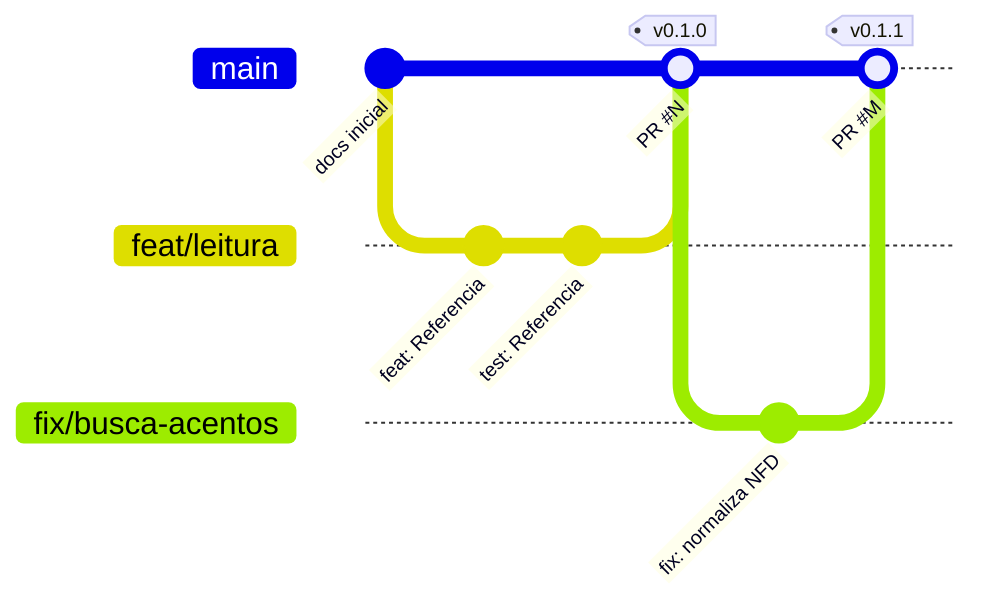

# 07 — Padrões de Desenvolvimento

| Campo | Valor |
|---|---|
| Versão | 0.1 (rascunho) |
| Data | 2026-11-22 |
| Status | Em revisão |

## 1. Fluxo de trabalho (GitHub Flow)



1. A `main` é sempre estável e publicável (deploy automático).
2. Todo trabalho é feito em uma **branch curta** criada a partir da `main`.
3. Integração somente via **Pull Request** com CI verde.
4. Após o merge, a branch é apagada.

### Nome das branches

`<tipo>/<descricao-curta-em-kebab-case>`

| Tipo | Uso | Exemplo |
|---|---|---|
| `feat/` | Nova funcionalidade | `feat/marca-texto` |
| `fix/` | Correção de bug | `fix/busca-acentos` |
| `docs/` | Documentação | `docs/arquitetura` |
| `refactor/` | Refatoração sem mudar comportamento | `refactor/mappers-dexie` |
| `test/` | Testes | `test/e2e-planos` |
| `chore/` | Build, dependências, configuração | `chore/atualiza-vite` |
| `ci/` | Pipelines | `ci/cobertura` |

## 2. Commits — Conventional Commits

```
<tipo>(<escopo opcional>): <descrição no imperativo, minúscula, sem ponto>

<corpo opcional: o quê e por quê>

<rodapé opcional: BREAKING CHANGE, Refs #issue>
```

| Tipo | Efeito no SemVer |
|---|---|
| `feat` | MINOR (0.**1**.0) |
| `fix`, `perf` | PATCH (0.1.**1**) |
| `feat!` / `BREAKING CHANGE:` | MAJOR (**1**.0.0) |
| `docs`, `style`, `refactor`, `test`, `build`, `ci`, `chore` | sem release |

Escopos sugeridos: `biblia`, `estudo`, `planos`, `busca`, `versoes`, `ui`, `pwa`, `dexie`, `docs`.

Exemplos:
```
feat(estudo): permite fundir destaques sobrepostos
fix(busca): ignora acentos na frase exata
docs(adr): adiciona ADR 0008 hospedagem
```

Validação automática: **commitlint** + **Husky** (hook `commit-msg`).

## 3. Versionamento e releases

- **SemVer** (`MAJOR.MINOR.PATCH`); `0.x` até o MVP completo; `1.0.0` = MVP entregue.
- Tags `vX.Y.Z` na `main`; **CHANGELOG.md** gerado a partir dos commits (`release-please` ou `changesets`).
- Releases publicadas no GitHub com as notas do CHANGELOG.

## 4. Pull Requests

- Título no formato Conventional Commits (vira a mensagem no squash).
- Template (`.github/pull_request_template.md`): resumo, requisitos/UC relacionados, como testar, checklist.
- PR pequeno (idealmente < 400 linhas alteradas).
- Estratégia de merge: **squash** para `feat`/`fix`; **merge commit** quando os commits contam a história (ex.: documentação por etapas).

## 5. Qualidade de código

| Ferramenta | Uso |
|---|---|
| TypeScript `strict` | `noUncheckedIndexedAccess`, `exactOptionalPropertyTypes` |
| ESLint | `typescript-eslint` (strict), `react-hooks`, `jsx-a11y`, `boundaries` |
| Prettier | Formatação única (sem discussões de estilo). Markdown fica de fora: tabelas compactas evitam diffs enormes |
| Husky + lint-staged | Lint/format nos arquivos alterados antes do commit |
| EditorConfig | Indentação e fim de linha consistentes |

### Convenções de código

- Identificadores conforme [ADR 0001](adr/0001-idioma-dos-identificadores.md).
- Arquivos de classes em `PascalCase.ts` (`Referencia.ts`); demais em `kebab-case.ts`.
- Um agregado/entidade por arquivo; testes ao lado: `Referencia.test.ts`.
- Value objects **imutáveis** (`readonly`, métodos retornam novas instâncias).
- Erros de domínio como classes (`ReferenciaInvalidaError`), nunca `throw "string"`.
- Sem `any`; sem `!` (non-null assertion) fora de testes.

## 6. CI (GitHub Actions)

Executado em todo PR e push na `main`:

```
install → lint → typecheck → test (unit + integração, com cobertura) → build → e2e (Playwright)
```

- PR só pode ser mergeado com CI verde (**branch protection** na `main`).
- Cobertura mínima do domínio: **80%** (falha abaixo disso).
- Deploy no GitHub Pages após merge na `main` ([ADR 0008](adr/0008-hospedagem-github-pages.md)).

## 7. Definition of Ready (DoR)

Uma história está pronta para desenvolvimento quando:
- [ ] Tem requisito(s) e/ou caso de uso relacionados.
- [ ] Critérios de aceite claros (Dado/Quando/Então).
- [ ] Wireframe definido (se houver UI).
- [ ] Impacto no modelo de domínio avaliado.

## 8. Definition of Done (DoD)

Uma história está pronta quando:
- [ ] Código segue a arquitetura e os padrões deste documento.
- [ ] Testes unitários do domínio/aplicação escritos e passando.
- [ ] Teste E2E do fluxo principal (quando houver UI).
- [ ] Lint, typecheck e build sem erros; CI verde.
- [ ] Acessível por teclado; sem violações `axe` críticas.
- [ ] Funciona offline (quando aplicável).
- [ ] Documentação atualizada (requisitos, diagramas, ADR se houve decisão nova).
- [ ] Roadmap ([09](09-roadmap.md)) e progresso do README atualizados, se o PR entrega uma fase.
- [ ] PR revisado e mergeado; CHANGELOG atualizado pela release.
